# Parallel Agent Session Tasks

This document describes the parallel agent workflow for the target Codebase. Each agent runs in its own Git worktree, feature branch, and container mounted only to its assigned directory. This isolation prevents agents from overwriting each other's changes, reduces merge conflicts, and keeps ownership of changes clear during review.

## Pre-Run Baseline

The run started from `main` at `2805cdd`. The output below was captured after the run from `git log`, because the original pre-run baseline capture came from an earlier attempt.

Verification:

```bash
git log --oneline --graph -6 main
```

Actual Output:

```bash
$ git log --oneline --graph -6 main
*   bca8370 Merge branch 'feature/agent-b'
|\  
| * 7332b74 Agent B changes
* | 866787e Agent A changes
|/  
* 4617c95 Define parallel agent session tasks
* 2805cdd log: Lab 3 - Run a Full Calibration Cycle
* bfe3266 eval: holdout measurement complete, 157/168 checks passing on the holdout set
```

The history shows `4617c95` (the scope-contract commit) directly on top of `2805cdd`, with both agent branches (`866787e`, `7332b74`) branching from `4617c95`.

## Scope Contract Commitment

Before creating the agent worktrees, a `session_tasks.md` template was committed to `main` as `4617c95`. It listed each session's required fields (branch, worktree, task, write scope, read-only scope, commands, definition of done). The field values shown in the Session A and Session B sections below were filled in after the worktrees were created.

```bash
git add session_tasks.md
git commit -m "Define parallel agent session tasks"
git log --oneline -1
git show --stat --format='%h %ad %s' --date=iso 4617c95


User@DESKTOP-A52GAEQ MINGW64 ~/downloads/AgenticEngineer/BackendCapstone-BankingWeb-app (main)
$ git add session_tasks.md

User@DESKTOP-A52GAEQ MINGW64 ~/downloads/AgenticEngineer/BackendCapstone-BankingWeb-app (main)
$ git commit -m "Define parallel agent session tasks"
[main 4617c95] Define parallel agent session tasks
 1 file changed, 16 insertions(+), 683 deletions(-)

User@DESKTOP-A52GAEQ MINGW64 ~/downloads/AgenticEngineer/BackendCapstone-BankingWeb-app (main)
$ git log --oneline -1
4617c95 (HEAD -> main) Define parallel agent session tasks

$ git show --stat --format='%h %ad %s' --date=iso 4617c95
4617c95 2026-11-02 15:27:00 -0600 Define parallel agent session tasks

 session_tasks.md | 699 ++-----------------------------------------------------
 1 file changed, 16 insertions(+), 683 deletions(-)
```

Both worktrees were created from `4617c95` (see the `HEAD is now at 4617c95` lines in Sessions A and B), so both agents started from the same committed template. The completed scope values were not part of that commit, so they document the intended scope rather than a contract fixed before the run.

## Session A

**Branch name:** feature/agent-a  
**Worktree directory:** target-agent-a

**Task:**  
Create REST API controller test classes for `AdminController` and `CustomerController` using mocking. The tests should verify controller behavior, HTTP responses, request handling, and service interactions.

**Files the agent may write to:**
- `src/test/java/com/example/demo/AdminControllerTest.java`
- `src/test/java/com/example/demo/CustomerControllerTest.java`

**Files the agent may read but not write to:**
- `src/main/java/com/example/demo/AdminController.java`
- `src/main/java/com/example/demo/CustomerController.java`
- Related service classes
- `pom.xml`
- `README.md`
- Existing test files

**Write restriction:**
The agent may not modify any other source, test, configuration, documentation, or resource file.

**Commands the agent may run:**
- `mvn test`
- `mvn clean test`
- `git status`
- `git diff`

**Definition of done:**
- Test classes are created for `AdminController` and `CustomerController`.
- Tests use mocking frameworks (for example, Mockito with Spring Boot Test).
- REST API endpoints are tested with mocked service dependencies.
- Tests verify expected HTTP status codes and response data.
- All new tests pass successfully using `mvn test`.
- Changes are committed to the assigned branch with a meaningful commit message.

**From the root of your main Target Codebase, create worktree for session A.:**

Confirm the Repository is on the main branch and ensures that both worktrees branch off the same clean baseline, 
which makes the final merge straightforward.

```bash
git checkout main
git pull
git worktree add ../target-agent-a -b feature/agent-a
```
**Verify the worktrees :**

```bash
git worktree list
```

```bash

User@DESKTOP-A52GAEQ MINGW64 ~/downloads/AgenticEngineer/BackendCapstone-BankingWeb-app (main)
$ git checkout main
Already on 'main'
Your branch is up to date with 'origin/main'.
User@DESKTOP-A52GAEQ MINGW64 ~/downloads/AgenticEngineer/BackendCapstone-BankingWeb-app (main)
$ git pull
Already up to date.

User@DESKTOP-A52GAEQ MINGW64 ~/downloads/AgenticEngineer/BackendCapstone-BankingWeb-app (main)
$ git worktree add ../target-agent-a -b feature/agent-a
Preparing worktree (new branch 'feature/agent-a')
HEAD is now at 4617c95 Define parallel agent session tasks

User@DESKTOP-A52GAEQ MINGW64 ~/downloads/AgenticEngineer/BackendCapstone-BankingWeb-app (main)
$ git worktree list
C:/Users/User/Downloads/AgenticEngineer/BackendCapstone-BankingWeb-app 4617c95 [main]
C:/Users/User/Downloads/AgenticEngineer/target-agent-a                 4617c95 [feature/agent-a]

User@DESKTOP-A52GAEQ MINGW64 ~/downloads/AgenticEngineer/BackendCapstone-BankingWeb-app (main)
$ git worktree list
C:/Users/User/Downloads/AgenticEngineer/BackendCapstone-BankingWeb-app 4617c95 [main]
C:/Users/User/Downloads/AgenticEngineer/target-agent-a                 4617c95 [feature/agent-a]

User@DESKTOP-A52GAEQ MINGW64 ~/downloads/AgenticEngineer/BackendCapstone-BankingWeb-app (main)
$

```
verify worktree is on the correct branch:

```bash
cd ../target-agent-a
git branch
ls
```

The worktree was attached from WSL by checking out the existing `feature/agent-a` branch (created above in Git Bash), so the output says `checking out` rather than `new branch`. It still points at `4617c95`.

```bash
user@DESKTOP-A52GAEQ:/mnt/c/Users/User/downloads/AgenticEngineer/BackendCapstone-BankingWeb-app$ git worktree add ../target-agent-a feature/agent-a
Preparing worktree (checking out 'feature/agent-a')
Updating files: 100% (201/201), done.
HEAD is now at 4617c95 Define parallel agent session tasks
user@DESKTOP-A52GAEQ:/mnt/c/Users/User/downloads/AgenticEngineer/BackendCapstone-BankingWeb-app$ cd ../target-agent-a
user@DESKTOP-A52GAEQ:/mnt/c/Users/User/downloads/AgenticEngineer/target-agent-a$ git branch
* feature/agent-a
  feature/agent-a1
+ main
  setup-review-fixes
user@DESKTOP-A52GAEQ:/mnt/c/Users/User/downloads/AgenticEngineer/target-agent-a$
```

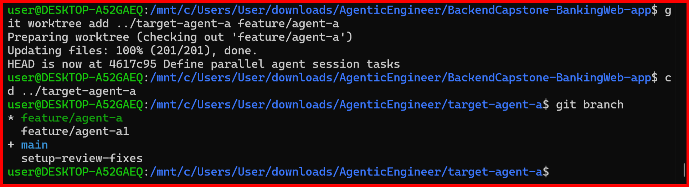

The `ls` below was captured after the run, when the same `feature/agent-a` branch was re-mounted (now at the merged Agent A commit `866787e`) to record the worktree contents:

```bash
user@DESKTOP-A52GAEQ:/mnt/c/Users/User/downloads/AgenticEngineer/target-agent-a$ ls
CLAUDE.md             img35.png   img_16.png  img_3.png   img_8.png                      settings.json
Dockerfile            img_1.png   img_17.png  img_30.png  img_9.png                      setup.md
README.md             img_10.png  img_2.png   img_31.png  lesson-4-lab-submission.patch  src
docker-entrypoint.sh  img_11.png  img_20.png  img_33.png  mcp                            statusline.sh
docs                  img_12.png  img_21.png  img_4.png   mvnw                           summary.txt
eval                  img_13.png  img_22.png  img_5.png   mvnw.cmd
handoff-phase-one.md  img_14.png  img_23.png  img_6.png   pom.xml
img.png               img_15.png  img_24.png  img_7.png   session_tasks.md
```

Launch the container in the terminal 1:

docker run -it --rm \
-v "${PWD}:/workspace" \
-v "claude-auth:/claude-auth" \
backend-banking-capstone-app

Verify the container sees only the Session A worktree. This was captured from the same re-mount of `feature/agent-a` (`866787e`) after the run:

```bash
user@DESKTOP-A52GAEQ:/mnt/c/Users/User/downloads/AgenticEngineer/target-agent-a$ docker run -it --rm -v "${PWD}:/workspace" -v "claude-auth:/claude-auth" backend-banking-capstone-app
Slack MCP not configured (SLACK_BOT_TOKEN/SLACK_TEAM_ID unset); skipping.
Added stdio MCP server gmail with command: node /usr/local/lib/node_modules/@gongrzhe/server-gmail-autoauth-mcp/dist/index.js to local config
File modified: /root/.claude.json [project: /workspace]
 * Starting MariaDB database server mariadbd                                                                         [ OK ]
Database ready: db_world
ai-course:/workspace# ls /workspace
CLAUDE.md             img.png     img_14.png  img_22.png  img_4.png                      mcp               src
Dockerfile            img35.png   img_15.png  img_23.png  img_5.png                      mvnw              statusline.sh
README.md             img_1.png   img_16.png  img_24.png  img_6.png                      mvnw.cmd          summary.txt
docker-entrypoint.sh  img_10.png  img_17.png  img_3.png   img_7.png                      pom.xml
docs                  img_11.png  img_2.png   img_30.png  img_8.png                      session_tasks.md
eval                  img_12.png  img_20.png  img_31.png  img_9.png                      settings.json
handoff-phase-one.md  img_13.png  img_21.png  img_33.png  lesson-4-lab-submission.patch  setup.md
ai-course:/workspace#
```

The container's `/workspace` lists the same files as the host `target-agent-a` worktree above, so the container sees only Session A's worktree.

and use Claude inside container to execute the task

Actual Result:

```bash
❯ Create REST API test classes for 'AdminController' and 'CustomerController' using mocking. The…
import com.example.demo.model.ChequeRequest;
import com.example.demo.model.Customer;
import com.example.demo.model.FundsTransfer;
import com.example.demo.model.Transaction;
import com.example.demo.service.CustomerService;
import com.fasterxml.jackson.databind.ObjectMapper;
… +511 lines

  Ran 1 shell command

I wrote both test classes from scratch, and all 49 tests pass: 22 for AdminController and 27 for CustomerController.

Files
- src/test/java/com/example/demo/AdminControllerTest.java
- src/test/java/com/example/demo/CustomerControllerTest.java

```


After both agents finish, use git status and git diff main commands in order to inspect each worktree separately against main.

```bash

user@DESKTOP-A52GAEQ:/mnt/c/Users/User/downloads/AgenticEngineer/target-agent-a$ git status
On branch feature/agent-a
Changes not staged for commit:
  (use "git add <file>..." to update what will be committed)
  (use "git restore <file>..." to discard changes in working directory)
        modified:   src/test/java/com/example/demo/AdminControllerTest.java
        modified:   src/test/java/com/example/demo/CustomerControllerTest.java

no changes added to commit (use "git add" and/or "git commit -a")
user@DESKTOP-A52GAEQ:/mnt/c/Users/User/downloads/AgenticEngineer/target-agent-a$ git diff main
diff --git a/src/test/java/com/example/demo/AdminControllerTest.java b/src/test/java/com/example/demo/AdminControllerTest.java
index c4d1943..dab9c74 100644
--- a/src/test/java/com/example/demo/AdminControllerTest.java
+++ b/src/test/java/com/example/demo/AdminControllerTest.java
@@ -1,10 +1,16 @@
 package com.example.demo;

 import com.example.demo.controller.AdminController;
-import com.example.demo.model.*;
+import com.example.demo.model.Account;
+import com.example.demo.model.BankAdmin;
+import com.example.demo.model.ChequeRequest;
+import com.example.demo.model.Customer;
+import com.example.demo.model.FundsTransfer;
+import com.example.demo.model.Transaction;
 import com.example.demo.service.AdminService;
 import com.fasterxml.jackson.databind.ObjectMapper;
 import org.junit.jupiter.api.BeforeEach;
+import org.junit.jupiter.api.DisplayName;
 import org.junit.jupiter.api.Test;
 import org.mockito.ArgumentCaptor;
 import org.springframework.beans.factory.annotation.Autowired;
@@ -13,15 +19,18 @@ import org.springframework.boot.test.mock.mockito.MockBean;
:

```

```bash

diff --git a/src/test/java/com/example/demo/CustomerControllerTest.java b/src/test/java/com/example/demo/CustomerControllerTest.java
index 0dacd0b..913c81c 100644
--- a/src/test/java/com/example/demo/CustomerControllerTest.java
+++ b/src/test/java/com/example/demo/CustomerControllerTest.java
@@ -1,10 +1,15 @@
package com.example.demo;

import com.example.demo.controller.CustomerController;
-import com.example.demo.model.*;
+import com.example.demo.model.Account;
+import com.example.demo.model.ChequeRequest;
+import com.example.demo.model.Customer;
+import com.example.demo.model.FundsTransfer;
+import com.example.demo.model.Transaction;
import com.example.demo.service.CustomerService;
import com.fasterxml.jackson.databind.ObjectMapper;
import org.junit.jupiter.api.BeforeEach;
+import org.junit.jupiter.api.DisplayName;
import org.junit.jupiter.api.Test;
import org.mockito.ArgumentCaptor;
import org.springframework.beans.factory.annotation.Autowired;
@@ -24,6 +29,7 @@ import static org.mockito.ArgumentMatchers.eq;
import static org.mockito.Mockito.times;
:

```

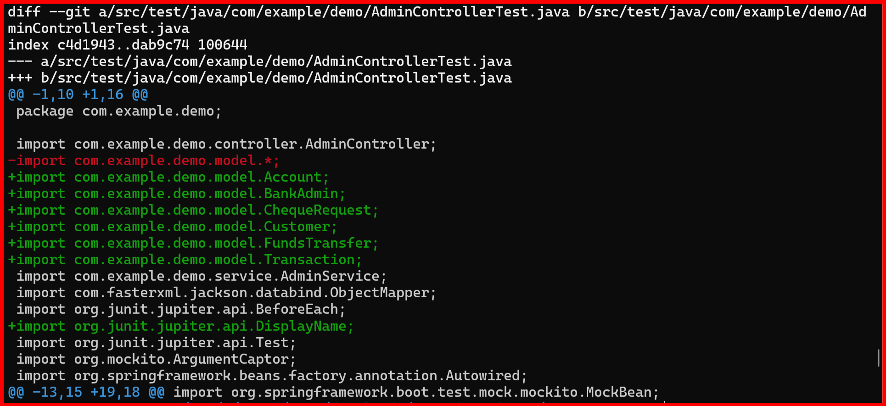

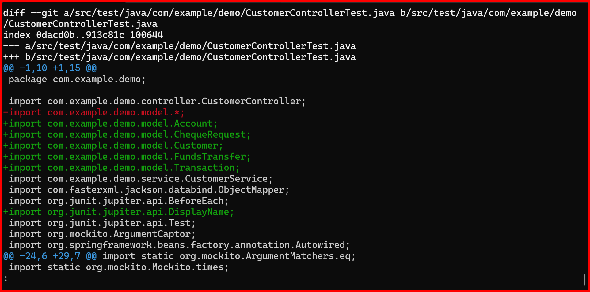


## Session B

**Branch name:** feature/agent-b  
**Worktree directory:** target-agent-b

**Task:**  
Update README.md with documentation describing the parallel multi-agent workflow, including worktree setup, agent responsibilities, container execution, and merge workflow.

**Files or folders the agent may write to:**
- `README.md`

**Files or folders the agent may read but not write to:**
- `src/main/java/**`
- `src/test/java/**`
- `pom.xml`
- Existing application source files

**Commands the agent may run:**
- `git status`
- `git diff`
- `git log`
- `git branch`
- `mvn test` (optional verification only)

**Definition of done:**
- README.md contains clear documentation of the parallel agent workflow.
- Documentation explains worktree creation, container execution, and merge process.
- Changes are committed with a meaningful commit message.

**From the root of your main target Codebase, create worktree for session B.:**

Confirm the Repository is on the main branch and ensures that both worktrees branch off the same clean baseline,
which makes the final merge straightforward.

```bash
git checkout main
git pull
git worktree add ../target-agent-b -b feature/agent-b
```

**Verify the worktrees :**

```bash
git worktree list
```

```bash

User@DESKTOP-A52GAEQ MINGW64 ~/downloads/AgenticEngineer/BackendCapstone-BankingWeb-app (main)
$ git checkout main
Already on 'main'
Your branch is up to date with 'origin/main'.
User@DESKTOP-A52GAEQ MINGW64 ~/downloads/AgenticEngineer/BackendCapstone-BankingWeb-app (main)
$ git pull
Already up to date.
user@DESKTOP-A52GAEQ:/mnt/c/Users/User/Downloads/AgenticEngineer/BackendCapstone-BankingWeb-app$ git worktree add ../target-agent-b -b feature/agent-b
Preparing worktree (new branch 'feature/agent-b')
Updating files: 100% (201/201), done.
HEAD is now at 4617c95 Define parallel agent session tasks
user@DESKTOP-A52GAEQ:/mnt/c/Users/User/Downloads/AgenticEngineer/BackendCapstone-BankingWeb-app$ git worktree list
/mnt/c/Users/User/Downloads/AgenticEngineer/BackendCapstone-BankingWeb-app 4617c95 [main]
/mnt/c/Users/User/downloads/AgenticEngineer/target-agent-a                 4617c95 [feature/agent-a]
/mnt/c/Users/User/Downloads/AgenticEngineer/target-agent-b                 4617c95 [feature/agent-b]
user@DESKTOP-A52GAEQ:/mnt/c/Users/User/Downloads/AgenticEngineer/BackendCapstone-BankingWeb-app$

```

verify worktree is on the correct branch:

```bash
cd ../target-agent-b
ls
git branch
```

```bash
user@DESKTOP-A52GAEQ:/mnt/c/Users/User/Downloads/AgenticEngineer/BackendCapstone-BankingWeb-app$ cd ../target-agent-b
user@DESKTOP-A52GAEQ:/mnt/c/Users/User/Downloads/AgenticEngineer/target-agent-b$ ls
CLAUDE.md             img35.png     img_16.png  img_3.png   img_8.png                      settings.json
Dockerfile            img_1.png     img_17.png  img_30.png  img_9.png                      setup.md
README.md             img_10.png    img_2.png   img_31.png  lesson-4-lab-submission.patch  src
docker-entrypoint.sh  img_11.png    img_20.png  img_33.png  mcp                            statusline.sh
docs                  img_12.png    img_21.png  img_4.png   mvnw                           summary.txt
eval                  img_13.png    img_22.png  img_5.png   mvnw.cmd
handoff-phase-one.md  img_14.png    img_23.png  img_6.png   pom.xml
img.png               img_15.png    img_24.png  img_7.png   session_tasks.md
user@DESKTOP-A52GAEQ:/mnt/c/Users/User/Downloads/AgenticEngineer/target-agent-b$ git branch
+ feature/agent-a
  feature/agent-a1
* feature/agent-b
+ main
  setup-review-fixes
user@DESKTOP-A52GAEQ:/mnt/c/Users/User/Downloads/AgenticEngineer/target-agent-b$
```

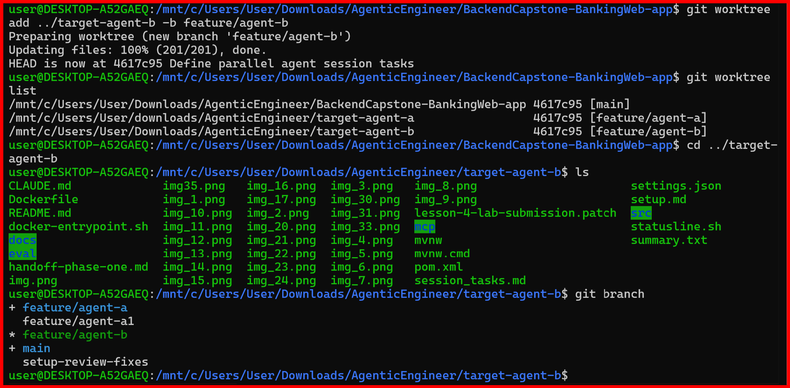

The output below was captured after the run, when the same `feature/agent-b` branch was re-mounted (now at the Agent B commit `7332b74`) to record the worktree contents:

```bash
user@DESKTOP-A52GAEQ:/mnt/c/Users/User/downloads/AgenticEngineer/BackendCapstone-BankingWeb-app$ git worktree add ../target-agent-b feature/agent-b
Preparing worktree (checking out 'feature/agent-b')
Updating files: 100% (201/201), done.
HEAD is now at 7332b74 Agent B changes
user@DESKTOP-A52GAEQ:/mnt/c/Users/User/downloads/AgenticEngineer/BackendCapstone-BankingWeb-app$ cd ../target-agent-b
user@DESKTOP-A52GAEQ:/mnt/c/Users/User/downloads/AgenticEngineer/target-agent-b$ ls
CLAUDE.md             img.png     img_14.png  img_22.png  img_4.png                      mcp               src
Dockerfile            img35.png   img_15.png  img_23.png  img_5.png                      mvnw              statusline.sh
README.md             img_1.png   img_16.png  img_24.png  img_6.png                      mvnw.cmd          summary.txt
docker-entrypoint.sh  img_10.png  img_17.png  img_3.png   img_7.png                      pom.xml
docs                  img_11.png  img_2.png   img_30.png  img_8.png                      session_tasks.md
eval                  img_12.png  img_20.png  img_31.png  img_9.png                      settings.json
handoff-phase-one.md  img_13.png  img_21.png  img_33.png  lesson-4-lab-submission.patch  setup.md
```

Launch the container in the terminal 2:

docker run -it --rm \
-v "${PWD}:/workspace" \
-v "claude-auth:/claude-auth" \
backend-banking-capstone-app

Verify the container sees only the Session B worktree. This was captured from the same re-mount of `feature/agent-b` (`7332b74`) after the run:

```bash
user@DESKTOP-A52GAEQ:/mnt/c/Users/User/downloads/AgenticEngineer/target-agent-b$ docker run -it --rm -v "${PWD}:/workspace" -v "claude-auth:/claude-auth" backend-banking-capstone-app
Slack MCP not configured (SLACK_BOT_TOKEN/SLACK_TEAM_ID unset); skipping.
Added stdio MCP server gmail with command: node /usr/local/lib/node_modules/@gongrzhe/server-gmail-autoauth-mcp/dist/index.js to local config
File modified: /root/.claude.json [project: /workspace]
 * Starting MariaDB database server mariadbd                                                                         [ OK ]
Database ready: db_world
ai-course:/workspace# ls /workspace
CLAUDE.md             img.png     img_14.png  img_22.png  img_4.png                      mcp               src
Dockerfile            img35.png   img_15.png  img_23.png  img_5.png                      mvnw              statusline.sh
README.md             img_1.png   img_16.png  img_24.png  img_6.png                      mvnw.cmd          summary.txt
docker-entrypoint.sh  img_10.png  img_17.png  img_3.png   img_7.png                      pom.xml
docs                  img_11.png  img_2.png   img_30.png  img_8.png                      session_tasks.md
eval                  img_12.png  img_20.png  img_31.png  img_9.png                      settings.json
handoff-phase-one.md  img_13.png  img_21.png  img_33.png  lesson-4-lab-submission.patch  setup.md
ai-course:/workspace#
```

The container's `/workspace` lists exactly the same files as the host `target-agent-b` worktree above, so the container sees only Session B's worktree.

and use Claude inside container to execute the task

Actual Result:

```bash

so I'll proceed with the docs update directly.

● Bash(cat >> README.md <<'EOF'…)
 .claude/agents/orchestrator.md                     | 218 +++---
 .claude/agents/planner.md                          | 122 ++--
 .claude/agents/project-manager.md                  |  90 +--
… +20 lines
Updated README.md (+174 -0)
**Architecture and Code Structure:**

The backend follows a layered Spring Boot architecture, with controllers responsible for REST endpoints, s
ervices containing business logic, repositories providing database access through Spring Data JPA, and mod
el/entity classes representing the application's relational data. The application separates customer and a
dministrator functionality, allowing banking operations and administrative approval workflows to be develo
ped and maintained independently.

## Parallel Multi-Agent Workflow

This repository supports running multiple Claude Code agents at the same time. Each agent gets its own **G
it worktree**, its own **feature branch**, and its own **container**, and each container mounts only that
agent's worktree. Every agent also has a written, non-overlapping write scope. Together these keep agents

```

```bash

The diff stat shows many unexpected files, likely due to line-ending differences or a prior git ownership check failure making the clean status unreliable. I'll verify this before proceeding.

  Ran 1 shell command

I added a "Parallel Multi-Agent Workflow" section to README.md. The existing intro is unchanged. Nothing is committed yet.

Something to check first: the README you had on disk didn't match the last commit. The committed version (541 lines) already has a long "Parallel Multi-Agent Workflow" section, with Agent A on controllers/services and Agent B on repositories/entities/tests. Your working copy had cut that back to just the intro before I started, so I added the new section to your working copy. If you meant to keep the committed version, tell me and I'll merge the two instead. session_tasks.md also had changes that weren't committed yet. Those were already there and I didn't touch them; the CRLF-only differences in other files weren't from me either.

```

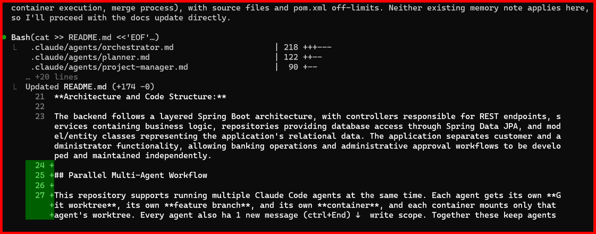

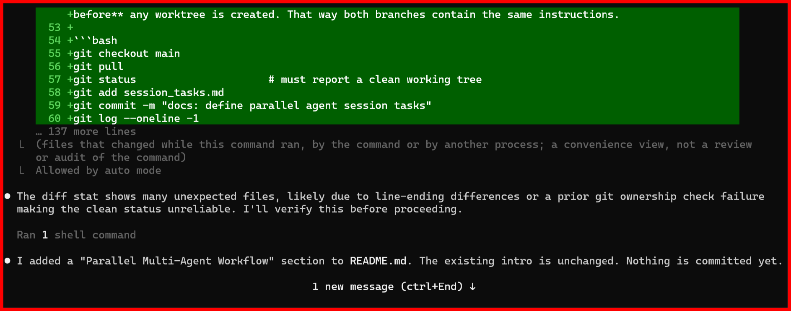

After both agents finish, use git status and git diff main commands in order to inspect each worktree separately against main.

```bash
user@DESKTOP-A52GAEQ:/mnt/c/Users/User/downloads/AgenticEngineer/target-agent-b$ git status
On branch feature/agent-b
Changes not staged for commit:
  (use "git add <file>..." to update what will be committed)
  (use "git restore <file>..." to discard changes in working directory)
        modified:   README.md

no changes added to commit (use "git add" and/or "git commit -a")
user@DESKTOP-A52GAEQ:/mnt/c/Users/User/downloads/AgenticEngineer/target-agent-b$ git diff main
diff --git a/README.md b/README.md
index 2281eee..3fb8441 100644
--- a/README.md
+++ b/README.md
@@ -24,102 +24,258 @@ The backend follows a layered Spring Boot architecture, with controllers respons

 ## Parallel Multi-Agent Workflow

-This repository uses a dual-agent workflow powered by Claude Code. Each agent runs in an isolated **Git worktree** and **Docker container** to allow parallel development without merge conflicts.
+This repository supports running **two Claude Code agents in parallel** on the same codebase. Each agent works in its own **Git worktree** (a separate checkout on its own branch) and runs inside its own **Docker container**. Each agent's changes stay isolated until a human reviews and merges them into `main`.

```

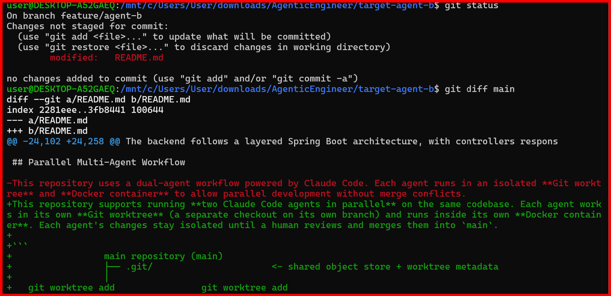

## Why These Tasks Can Run in Parallel

The two sessions were intentionally assigned non-overlapping write scopes.

- **Session A** writes only to:
    - `src/test/java/com/example/demo/AdminControllerTest.java`
    - `src/test/java/com/example/demo/CustomerControllerTest.java`
- **Session B** writes only to:
    - `README.md`

Both sessions are allowed to read the production source code, `pom.xml`, and other existing application files, but neither session is permitted to modify them. Keeping these shared resources read-only ensures both agents work from the same codebase without introducing conflicting changes.

Because each session writes to a different part of the repository, they cannot overwrite each other's work or create file-level merge conflicts during development.

If both sessions were allowed to modify the same files (for example, `README.md`, `pom.xml`, or the controller source files), concurrent edits could result in merge conflicts, accidental overwrites, or difficulty determining which changes belong to each task. Restricting each session to separate write scopes keeps the work independent and makes review and merging straightforward.

## Shared Files Excluded From Write Scope

Both sessions were allowed to read shared files such as:

- `src/main/java/**`
- `pom.xml`
- Existing application source files

These files were excluded from write access because parallel changes to production code or shared configuration could create conflicts or unintended changes. Keeping them read-only allowed both agents to work independently and made merging safer.

## Evaluation and Merge Verification

Each agent branch was reviewed independently against `main` before merging.

### Session A

```bash
cd ../target-agent-a
git status
git diff main
```

```bash
user@DESKTOP-A52GAEQ:/mnt/c/Users/User/downloads/AgenticEngineer/target-agent-a$ git status
On branch feature/agent-a
Changes not staged for commit:
  (use "git add <file>..." to update what will be committed)
  (use "git restore <file>..." to discard changes in working directory)
        modified:   src/test/java/com/example/demo/AdminControllerTest.java
        modified:   src/test/java/com/example/demo/CustomerControllerTest.java

no changes added to commit (use "git add" and/or "git commit -a")
user@DESKTOP-A52GAEQ:/mnt/c/Users/User/downloads/AgenticEngineer/target-agent-a$ git diff main
diff --git a/src/test/java/com/example/demo/AdminControllerTest.java b/src/test/java/com/example/demo/AdminControllerTest.java
index c4d1943..dab9c74 100644
--- a/src/test/java/com/example/demo/AdminControllerTest.java
+++ b/src/test/java/com/example/demo/AdminControllerTest.java
...
diff --git a/src/test/java/com/example/demo/CustomerControllerTest.java b/src/test/java/com/example/demo/CustomerControllerTest.java
index 0dacd0b..913c81c 100644
--- a/src/test/java/com/example/demo/CustomerControllerTest.java
+++ b/src/test/java/com/example/demo/CustomerControllerTest.java
@@ -1,10 +1,15 @@
package com.example.demo;

import com.example.demo.controller.CustomerController;
-import com.example.demo.model.*;
+import com.example.demo.model.Account;
+import com.example.demo.model.ChequeRequest;
+import com.example.demo.model.Customer;
+import com.example.demo.model.FundsTransfer;
+import com.example.demo.model.Transaction;
import com.example.demo.service.CustomerService;
import com.fasterxml.jackson.databind.ObjectMapper;
import org.junit.jupiter.api.BeforeEach;
+import org.junit.jupiter.api.DisplayName;
import org.junit.jupiter.api.Test;
import org.mockito.ArgumentCaptor;
import org.springframework.beans.factory.annotation.Autowired;
@@ -24,6 +29,7 @@ import static org.mockito.ArgumentMatchers.eq;
import static org.mockito.Mockito.times;
:

```


**Correctness and usefulness:**  
The agent rewrote the existing `AdminControllerTest.java` and `CustomerControllerTest.java` (the diff shows both files as modified, `index c4d1943..dab9c74` and `index 0dacd0b..913c81c`). The tests cover the assigned controller behavior, mocked service interactions, HTTP responses, and response data. The agent reported that `mvn test` passed (49 tests: 22 for `AdminController`, 27 for `CustomerController`). The Maven test report itself was not captured for this run, so that count rests on the agent's summary.

**Quality finding:**  
`updateCustomer()` in `CustomerControllerTest` does more than check for `200 OK`:

```java
mockMvc.perform(put(BASE + "/updateCustomer/{id}", 1L)
                .contentType(MediaType.APPLICATION_JSON)
                .content(json(request)))
        .andExpect(status().isOk())
        .andExpect(jsonPath("$.customerId").value(1))
        .andExpect(jsonPath("$.firstName").value("Johnny"));

ArgumentCaptor<Customer> captor = ArgumentCaptor.forClass(Customer.class);
verify(customerService).updateCustomer(captor.capture(), eq(1L));
verifyNoMoreInteractions(customerService);
assertEquals("Johnny", captor.getValue().getFirstName());
```

The `ArgumentCaptor` confirms the request body reaches the service with `firstName = "Johnny"`. The `eq(1L)` confirms the `{id}` path variable is passed through. `verifyNoMoreInteractions` confirms the controller makes no extra service calls. The test would therefore fail if the controller dropped the path id, bound the body incorrectly or called the wrong service method. That makes it real coverage of the controller's behavior rather than a status-code check, which supports the merge decision.

**Scope adherence:**  
`git diff main` showed only:
- `src/test/java/com/example/demo/AdminControllerTest.java`
- `src/test/java/com/example/demo/CustomerControllerTest.java`

No production source, README, configuration, or unrelated test files were modified.

**Production appropriateness:**  
The changes add automated controller test coverage without modifying application behavior or production source code. With the tests reported as passing and the assertions checked directly (see the quality finding), the changes were considered appropriate to merge.

**Definition of done:**  
Both test classes were delivered, mocking was used, the required endpoint behavior was tested, and the tests were reported as passing. The branch was committed as `866787e`, but its message, `Agent A changes`, is generic rather than meaningful, so that part of the definition of done was only partly met.

**Merge decision:** Approved.

**Reason:** The diff matched the assigned file-level scope, and the `updateCustomer()` assertions showed the tests check real controller behavior. The generic commit message was noted but did not block the merge, because it doesn't affect the code.

### Session B

```bash
cd ../target-agent-b
git status
git diff main
```

```bash
user@DESKTOP-A52GAEQ:/mnt/c/Users/User/downloads/AgenticEngineer/target-agent-b$ git status
On branch feature/agent-b
Changes not staged for commit:
  (use "git add <file>..." to update what will be committed)
  (use "git restore <file>..." to discard changes in working directory)
        modified:   README.md

no changes added to commit (use "git add" and/or "git commit -a")
user@DESKTOP-A52GAEQ:/mnt/c/Users/User/downloads/AgenticEngineer/target-agent-b$ git diff main
diff --git a/README.md b/README.md
index 2281eee..3fb8441 100644
--- a/README.md
+++ b/README.md
@@ -24,102 +24,258 @@ The backend follows a layered Spring Boot architecture, with controllers respons

 ## Parallel Multi-Agent Workflow

-This repository uses a dual-agent workflow powered by Claude Code. Each agent runs in an isolated **Git worktree** and **Docker container** to allow parallel development without merge conflicts.
+This repository supports running **two Claude Code agents in parallel** on the same codebase. Each agent works in its own **Git worktree** (a separate checkout on its own branch) and runs inside its own **Docker container**. Each agent's changes stay isolated until a human reviews and merges them into `main`.

```

**Correctness and usefulness:**  
The agent updated `README.md` with documentation covering the parallel workflow, worktree setup, container execution, agent responsibilities, and merge process.

**Quality finding:**  
The README's container instructions were checked against the container launch actually used in this run:

```bash
# README (feature/agent-b)
cd ../target-agent-a
docker run -it --rm \
  --name agent-a \
  -e SLACK_BOT_TOKEN="${SLACK_BOT_TOKEN:-}" \
  -e SLACK_TEAM_ID="${SLACK_TEAM_ID:-}" \
  -v "$PWD:/workspace" \
  -v claude-auth:/claude-auth \
  backend-banking-capstone-app

# Demonstrated run (Session A, terminal 1)
docker run -it --rm -v "${PWD}:/workspace" -v "claude-auth:/claude-auth" backend-banking-capstone-app
```

The image, the worktree mount (`$PWD:/workspace`) and the shared `claude-auth` volume match, and the README runs one container per worktree, as in the demonstrated run. The README also adds `--name agent-a/agent-b` and optional `SLACK_*` variables that the demonstrated run did not use. These are optional and don't change which directory each container can write to. The README therefore documents the workflow that was actually run, which supports the merge decision.

**Scope adherence:**  
`git diff main` showed only: `README.md`

The agent's own summary reported `Updated README.md (+174 -0)`. That count was measured against the working copy it found, which had already been trimmed (see the agent's note above). Measured against committed `main`, the diff hunk is `@@ -24,102 +24,258 @@` and the merge reports `198 insertions(+), 42 deletions(-)`. Both give the same net change of +156 lines, so the reviewed diff and the merged commit `7332b74` are the same change.

No source, test, configuration, or other files were modified.

**Production appropriateness:**  
The change is documentation-only and does not alter application behavior. The documentation is appropriate for explaining the demonstrated workflow.

**Definition of done:**  
The README contains the required workflow documentation. The branch was committed as `7332b74`, but its message, `Agent B changes`, is generic rather than meaningful, so that part of the definition of done was only partly met.

**Merge decision:** Approved.

**Reason:** The diff contained only the assigned README change and satisfied the Session B definition of done.

### Merge

```bash
cd ../BackendCapstone-BankingWeb-app
git merge feature/agent-a
git merge feature/agent-b
git log --oneline -4
```
The merge was performed only after reviewing each branch with `git diff main`. The merge commands were executed for both feature branches, followed by `git log --oneline -4` to verify the resulting history. `git status` after cleanup is shown in Final Cleanup below.

```bash
user@DESKTOP-A52GAEQ:/mnt/c/Users/User/downloads/AgenticEngineer/BackendCapstone-BankingWeb-app$ git merge feature/agent-a
Updating 4617c95..866787e
Fast-forward
 src/test/java/com/example/demo/AdminControllerTest.java    | 532 +++++++++++++++++++++++++----------------
 src/test/java/com/example/demo/CustomerControllerTest.java | 554 ++++++++++++++++++++++++++-----------------
 2 files changed, 651 insertions(+), 435 deletions(-)
user@DESKTOP-A52GAEQ:/mnt/c/Users/User/downloads/AgenticEngineer/BackendCapstone-BankingWeb-app$ git merge feature/agent-b
Merge made by the 'ort' strategy.
 README.md | 240 ++++++++++++++++++++++++++++++++++++++++++++++++++++++++++++++++++++++++++++----------------
 1 file changed, 198 insertions(+), 42 deletions(-)
user@DESKTOP-A52GAEQ:/mnt/c/Users/User/downloads/AgenticEngineer/BackendCapstone-BankingWeb-app$ git log --oneline -4
bca8370 (HEAD -> main) Merge branch 'feature/agent-b'
7332b74 (feature/agent-b) Agent B changes
866787e (feature/agent-a) Agent A changes
4617c95 Define parallel agent session tasks
```

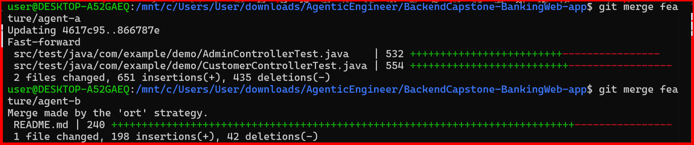

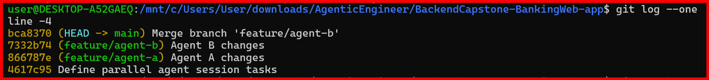

## Final Cleanup

```bash
git worktree remove ../target-agent-a
git worktree remove ../target-agent-b

git worktree list

git status
```

Expected result:

- Only the main worktree remains.
- `git status` reports a clean working tree.

Screenshot:

```bash
user@DESKTOP-A52GAEQ:/mnt/c/Users/User/downloads/AgenticEngineer/BackendCapstone-BankingWeb-app$ git worktree remove ../target-agent-a
user@DESKTOP-A52GAEQ:/mnt/c/Users/User/downloads/AgenticEngineer/BackendCapstone-BankingWeb-app$ git worktree remove ../target-agent-b
user@DESKTOP-A52GAEQ:/mnt/c/Users/User/downloads/AgenticEngineer/BackendCapstone-BankingWeb-app$ git worktree list
/mnt/c/Users/User/downloads/AgenticEngineer/BackendCapstone-BankingWeb-app bca8370 [main]
User@DESKTOP-A52GAEQ MINGW64 ~/downloads/AgenticEngineer/BackendCapstone-BankingWeb-app (main)
$ git status
On branch main
Your branch is up to date with 'origin/main'.

nothing to commit, working tree clean

User@DESKTOP-A52GAEQ MINGW64 ~/downloads/AgenticEngineer/BackendCapstone-BankingWeb-app (main)

```

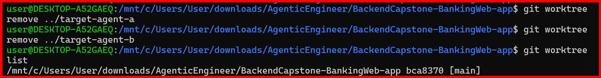
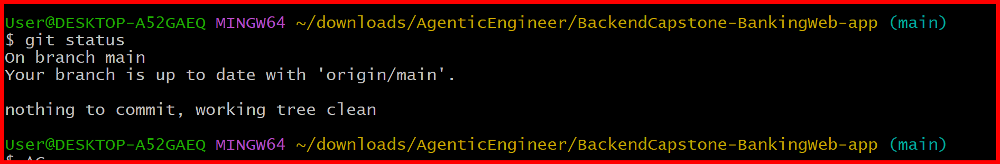

## Reflection

### Q1. What did you learn about defining parallel agent tasks?

This run showed that parallel tasks need both separate responsibilities and explicit file-level write boundaries. Session A focused on controller tests while Session B focused on README documentation, so the two tasks could be executed independently. Defining the expected output files also made post-run scope verification easier.

### Q2. How did the task definitions affect agent behavior?

Session A was directed to create only the two controller test classes, while Session B was directed to modify only README.md. This gave each agent a clear target and prevented the tasks from competing for the same files.

### Q3. What happened with merge conflicts, and why?

The branches merged without a file-level conflict because the write scopes were separated before the agents started. Session A modified the assigned test files and Session B modified README.md. The clean merge was therefore a result of deliberate task decomposition rather than relying on the agents to avoid each other's files.

### Q4. What judgment call required human oversight?

The worktree and container setup could verify branch and filesystem isolation, but it could not determine whether the generated tests provided meaningful coverage or whether the README documentation was sufficiently useful and production-appropriate. Those aspects required human review of the actual diffs and test results.

### Q5. How did the scope definition affect the merge outcome?

The non-overlapping scopes made the branches independently reviewable and reduced the possibility of conflicting edits. The Session A test files and Session B README change could be merged without competing modifications to the same file.

### Q6. What would you change in the next run?

**Did drift occur?** No scope drift occurred. Each `git diff main` contained only the files assigned to that session. Three gaps did show up, though, and each points to a specific change:
- Session A rewrote the existing controller tests "from scratch" (435 lines deleted) instead of adding to them, because the task said "create" while the files already existed.
- Session B found that its `README.md` working copy didn't match the last commit, and saw unrelated line-ending differences in its diff stat.
- Both agents committed with generic messages (`Agent A changes`, `Agent B changes`).

**Preventive changes (written into `session_tasks.md` before the run):**
1. **Commit the completed contract first.** Commit the fully filled-in `session_tasks.md` to `main` and record `git log` before creating either worktree. This time only the empty template was committed (`4617c95`).
2. **Add test-coverage requirements to Session A's definition of done:**
   - for every endpoint, at least one success test and one not-found or empty-result test;
   - every write endpoint (`POST`/`PUT`) must capture the service argument with `ArgumentCaptor` and check at least one field;
   - every test must call `verify(...)` on the expected service method, and end with `verifyNoMoreInteractions`;
   - existing test methods may be extended but not deleted. The agent must list any removed test method in its summary.
3. **Add README acceptance checks to Session B's definition of done:**
   - every `docker run` command in the README must use the same image, `/workspace` mount and `claude-auth` volume as the commands in `session_tasks.md`;
   - every `git worktree add` example must use the real branch names `feature/agent-a` and `feature/agent-b`;
   - the README must not describe agent responsibilities that differ from `session_tasks.md`.
4. **Add a pre-commit gate for both agents:** run `git status` and `git diff --stat main`, confirm that only the allowed files appear, paste that output into the summary, and use a commit message in the form `test: add AdminController and CustomerController tests` or `docs: document parallel agent workflow`.

**Corrective prompts (used only if drift is seen during the run):**
- If `git diff --stat main` shows a file outside the write scope: "Revert changes to `<file>` with `git restore <file>`. It is outside your write scope. Re-run `git diff --stat main` and confirm only your assigned files remain."
- If an agent starts deleting existing tests: "Stop. Restore the original test methods and add new tests alongside them."
- If the working copy doesn't match the last commit (as Session B found): "Do not edit yet. Report `git status` and `git diff --stat HEAD`, and wait for the human to confirm which version to start from."