# Parallel Agent Session Tasks

This document describes the parallel agent workflow for the target Codebase. Each agent runs in its own Git worktree, feature branch, and container mounted only to its assigned directory. This isolation prevents agents from overwriting each other's changes, reduces merge conflicts, and keeps ownership of changes clear during review.

## Pre-Run Baseline

Before creating either worktree, the repository was checked out to `main` and verified clean.

Verification:

```bash
git checkout main
git log --oneline -1
git worktree list
```

Actual Output:

```bash
user@DESKTOP-A52GAEQ:/mnt/c/Users/User/downloads/AgenticEngineer/BackendCapstone-BankingWeb-app$ git checkout main
Already on 'main'
Your branch is up to date with 'origin/main'.
user@DESKTOP-A52GAEQ:/mnt/c/Users/User/downloads/AgenticEngineer/BackendCapstone-BankingWeb-app$ git log --oneline -1
290ad52 (HEAD -> main, origin/main, origin/HEAD) docs: review comments fixed : add measured Runs 022/023 with cycle time, review latency and cost
user@DESKTOP-A52GAEQ:/mnt/c/Users/User/downloads/AgenticEngineer/BackendCapstone-BankingWeb-app$ git worktree list
/mnt/c/Users/User/downloads/AgenticEngineer/BackendCapstone-BankingWeb-app 290ad52 [main]
user@DESKTOP-A52GAEQ:/mnt/c/Users/User/downloads/AgenticEngineer/BackendCapstone-BankingWeb-app$
```

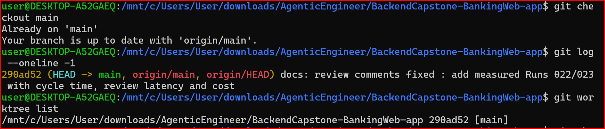

## Scope Contract Commitment

Before creating the agent worktrees, session_tasks.md was committed to main. This established the agents' responsibilities, file-level write restrictions, permitted commands, and definitions of done before execution.

```bash
git add session_tasks.md
git commit -m "docs: define parallel agent session tasks"
git log -1 --oneline

user@DESKTOP-A52GAEQ:/mnt/c/Users/User/downloads/AgenticEngineer/BackendCapstone-BankingWeb-app$ git add session_tasks.md
user@DESKTOP-A52GAEQ:/mnt/c/Users/User/downloads/AgenticEngineer/BackendCapstone-BankingWeb-app$ git commit -m "docs: define parallel agent session tasks"
[main 196bf7b] docs: define parallel agent session tasks
 1 file changed, 100 insertions(+), 837 deletions(-)
user@DESKTOP-A52GAEQ:/mnt/c/Users/User/downloads/AgenticEngineer/BackendCapstone-BankingWeb-app$ git log -1 --oneline
196bf7b (HEAD -> main) docs: define parallel agent session tasks
user@DESKTOP-A52GAEQ:/mnt/c/Users/User/downloads/AgenticEngineer/BackendCapstone-BankingWeb-app$
```
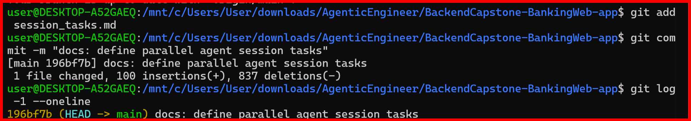

The scope-contract commit was completed before worktree creation. Both agent branches were created from the same committed main baseline, ensuring identical task instructions.

## Session A

**Branch name:** feature/agent-a  
**Worktree directory:** target-agent-a

**Task:**  
Create REST API controller test classes for `AdminController` and `CustomerController` using mocking. The tests should verify controller behavior, HTTP responses, request handling, and service interactions.

**Files the agent may write to:**
- `src/test/java/com/example/demo/AdminControllerTest.java`
- `src/test/java/com/example/demo/CustomerControllerTest.java`

**Files the agent may read but not write to:**
- `src/main/java/com/example/demo/AdminController.java`
- `src/main/java/com/example/demo/CustomerController.java`
- Related service classes
- `pom.xml`
- `README.md`
- Existing test files

**Write restriction:**
The agent may not modify any other source, test, configuration, documentation, or resource file.

**Commands the agent may run:**
- `mvn test`
- `mvn clean test`
- `git status`
- `git diff`

**Definition of done:**
- Test classes are created for `AdminController` and `CustomerController`.
- Tests use mocking frameworks (for example, Mockito with Spring Boot Test).
- REST API endpoints are tested with mocked service dependencies.
- Tests verify expected HTTP status codes and response data.
- All new tests pass successfully using `mvn test`.
- Changes are committed to the assigned branch with a meaningful commit message.

**From the root of your main Target Codebase, create worktree for session A.:**

Confirm the Repository is on the main branch and ensures that both worktrees branch off the same clean baseline,
which makes the final merge straightforward.

```bash
git checkout main
git pull
git worktree add ../target-agent-a -b feature/agent-a
```
**Verify the worktrees :**

```bash
git worktree list
```

```bash
user@DESKTOP-A52GAEQ:/mnt/c/Users/User/downloads/AgenticEngineer/BackendCapstone-BankingWeb-app$ git checkout main
Already on 'main'
Your branch is up to date with 'origin/main'.
user@DESKTOP-A52GAEQ:/mnt/c/Users/User/downloads/AgenticEngineer/BackendCapstone-BankingWeb-app$ git pull
Already up to date.
user@DESKTOP-A52GAEQ:/mnt/c/Users/User/downloads/AgenticEngineer/BackendCapstone-BankingWeb-app$ git worktree add ../target-agent-a -b feature/agent-a
Preparing worktree (new branch 'feature/agent-a')
Updating files: 100% (219/219), done.
HEAD is now at 196bf7b docs: define parallel agent session tasks
user@DESKTOP-A52GAEQ:/mnt/c/Users/User/downloads/AgenticEngineer/BackendCapstone-BankingWeb-app$ git worktree list
/mnt/c/Users/User/downloads/AgenticEngineer/BackendCapstone-BankingWeb-app 196bf7b [main]
/mnt/c/Users/User/downloads/AgenticEngineer/target-agent-a                 196bf7b [feature/agent-a]
```

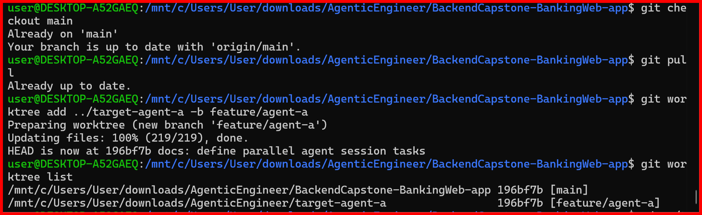

verify worktree is on the correct branch:

```bash
cd ../target-agent-a
ls
git branch
```

```bash
user@DESKTOP-A52GAEQ:/mnt/c/Users/User/downloads/AgenticEngineer/BackendCapstone-BankingWeb-app$ cd ../target-agent-a
user@DESKTOP-A52GAEQ:/mnt/c/Users/User/downloads/AgenticEngineer/target-agent-a$ ls
CLAUDE.md             img_12.png  img_24.png  img_36.png                     mcp
Dockerfile            img_13.png  img_25.png  img_37.png                     mvnw
README.md             img_14.png  img_26.png  img_38.png                     mvnw.cmd
docker-entrypoint.sh  img_15.png  img_27.png  img_39.png                     pom.xml
docs                  img_16.png  img_28.png  img_4.png                      session_tasks.md
egress-smoke.txt      img_17.png  img_29.png  img_40.png                     settings.json
eval                  img_18.png  img_3.png   img_41.png                     setup.md
handoff-phase-one.md  img_19.png  img_30.png  img_5.png                      src
img.png               img_2.png   img_31.png  img_6.png                      statusline.sh
img35.png             img_20.png  img_32.png  img_7.png                      summary.txt
img_1.png             img_21.png  img_33.png  img_8.png
img_10.png            img_22.png  img_34.png  img_9.png
img_11.png            img_23.png  img_35.png  lesson-4-lab-submission.patch
user@DESKTOP-A52GAEQ:/mnt/c/Users/User/downloads/AgenticEngineer/target-agent-a$ git branch
* feature/agent-a
  feature/agent-a-test
  feature/agent-a1
  feature/agent-b
+ main
  setup-review-fixes
```

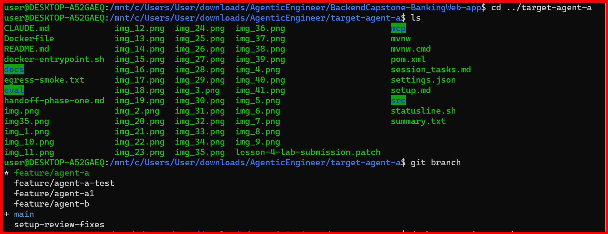

Launch the container in the terminal 1:

docker run -it --rm \
-v "${PWD}:/workspace" \
-v "claude-auth:/claude-auth" \
backend-banking-capstone-app

```bash
user@DESKTOP-A52GAEQ:/mnt/c/Users/User/downloads/AgenticEngineer/target-agent-a$ docker run -it --rm -v "${PWD}:/workspace" -v "claude-auth:/claude-auth" backend-banking-capstone-app
Slack MCP not configured (SLACK_BOT_TOKEN/SLACK_TEAM_ID unset); skipping.
Added stdio MCP server gmail with command: node /usr/local/lib/node_modules/@gongrzhe/server-gmail-autoauth-mcp/dist/index.js to local config
File modified: /root/.claude.json [project: /workspace]
 * Starting MariaDB database server mariadbd                                                     [ OK ]
Database ready: db_world
ai-course:/workspace# ls /workspace
CLAUDE.md             img_12.png  img_24.png  img_36.png                     mcp
Dockerfile            img_13.png  img_25.png  img_37.png                     mvnw
README.md             img_14.png  img_26.png  img_38.png                     mvnw.cmd
docker-entrypoint.sh  img_15.png  img_27.png  img_39.png                     pom.xml
docs                  img_16.png  img_28.png  img_4.png                      session_tasks.md
egress-smoke.txt      img_17.png  img_29.png  img_40.png                     settings.json
eval                  img_18.png  img_3.png   img_41.png                     setup.md
handoff-phase-one.md  img_19.png  img_30.png  img_5.png                      src
img.png               img_2.png   img_31.png  img_6.png                      statusline.sh
img35.png             img_20.png  img_32.png  img_7.png                      summary.txt
img_1.png             img_21.png  img_33.png  img_8.png
img_10.png            img_22.png  img_34.png  img_9.png
img_11.png            img_23.png  img_35.png  lesson-4-lab-submission.patch
ai-course:/workspace#
```
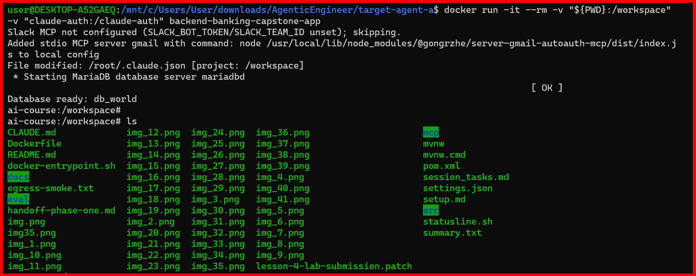

and use Claude inside container to execute the task

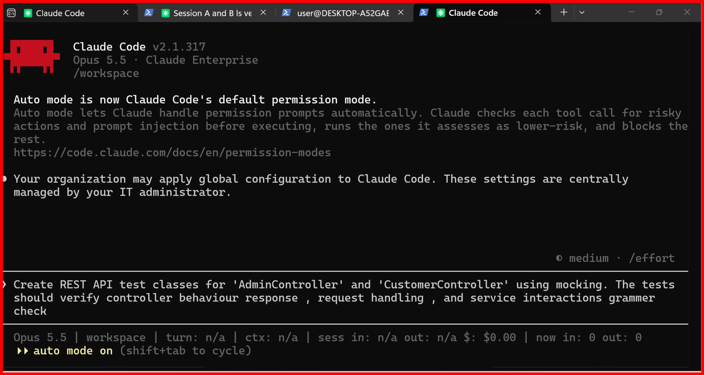

Actual Result:

```bash

Ran 1 shell command

All 55 new tests pass (./mvnw test, exit code 0):

AdminControllerTest     Tests run: 26, Failures: 0, Errors: 0, Skipped: 0
CustomerControllerTest  Tests run: 29, Failures: 0, Errors: 0, Skipped: 0

Files: src/test/java/com/example/demo/AdminControllerTest.java and src/test/java/com/example/demo/CustomerControllerTest.java. They're in the same location and package as before and use only Java 8 features.
```

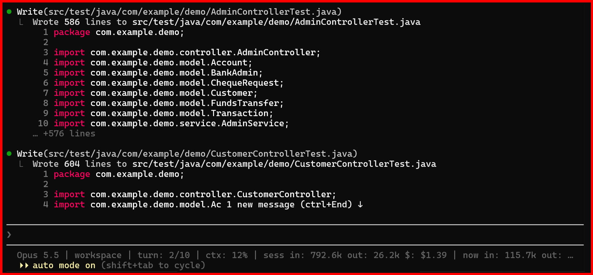

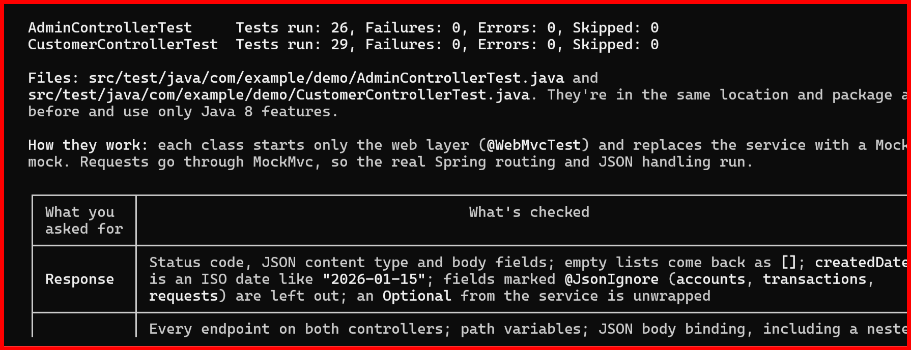

After agents finish, use git status and git diff main commands in order to inspect each worktree separately against main.

```bash
user@DESKTOP-A52GAEQ:/mnt/c/Users/User/downloads/AgenticEngineer/target-agent-a$ git status
On branch feature/agent-a
Changes not staged for commit:
  (use "git add <file>..." to update what will be committed)
  (use "git restore <file>..." to discard changes in working directory)
        modified:   src/test/java/com/example/demo/AdminControllerTest.java
        modified:   src/test/java/com/example/demo/CustomerControllerTest.java

no changes added to commit (use "git add" and/or "git commit -a")
user@DESKTOP-A52GAEQ:/mnt/c/Users/User/downloads/AgenticEngineer/target-agent-a$ git diff main
diff --git a/src/test/java/com/example/demo/AdminControllerTest.java b/src/test/java/com/example/demo/AdminControllerTest.java
index dab9c74..cb016d9 100644
diff --git a/src/test/java/com/example/demo/AdminControllerTest.java b/src/test/java/com/example/demo/AdminCon
trollerTest.java
index dab9c74..cb016d9 100644
--- a/src/test/java/com/example/demo/AdminControllerTest.java
+++ b/src/test/java/com/example/demo/AdminControllerTest.java
@@ -9,7 +9,6 @@ import com.example.demo.model.FundsTransfer;
 import com.example.demo.model.Transaction;
 import com.example.demo.service.AdminService;
 import com.fasterxml.jackson.databind.ObjectMapper;
-import org.junit.jupiter.api.BeforeEach;
 import org.junit.jupiter.api.DisplayName;
 import org.junit.jupiter.api.Test;
 import org.mockito.ArgumentCaptor;
@@ -19,12 +18,14 @@ import org.springframework.boot.test.mock.mockito.MockBean;
 import org.springframework.http.MediaType;
 import org.springframework.test.web.servlet.MockMvc;

+import java.time.LocalDate;
 import java.util.Arrays;
 import java.util.Collections;

 import static org.hamcrest.Matchers.hasSize;
 import static org.junit.jupiter.api.Assertions.assertEquals;
 import static org.junit.jupiter.api.Assertions.assertNull;
+import static org.junit.jupiter.api.Assertions.assertThrows;
 import static org.mockito.ArgumentMatchers.any;
 import static org.mockito.ArgumentMatchers.eq;
 
```

```bash

diff --git a/src/test/java/com/example/demo/CustomerControllerTest.java b/src/test/java/com/example/demo/CustomerControllerTest.java
index 913c81c..08dcccf 100644
--- a/src/test/java/com/example/demo/CustomerControllerTest.java
+++ b/src/test/java/com/example/demo/CustomerControllerTest.java
@@ -8,7 +8,6 @@ import com.example.demo.model.FundsTransfer;
 import com.example.demo.model.Transaction;
 import com.example.demo.service.CustomerService;
 import com.fasterxml.jackson.databind.ObjectMapper;
-import org.junit.jupiter.api.BeforeEach;
 import org.junit.jupiter.api.DisplayName;
 import org.junit.jupiter.api.Test;
 import org.mockito.ArgumentCaptor;
@@ -24,8 +23,12 @@ import java.util.Optional;

 import static org.hamcrest.Matchers.hasSize;
 import static org.junit.jupiter.api.Assertions.assertEquals;
+import static org.junit.jupiter.api.Assertions.assertNull;
+import static org.junit.jupiter.api.Assertions.assertThrows;

```

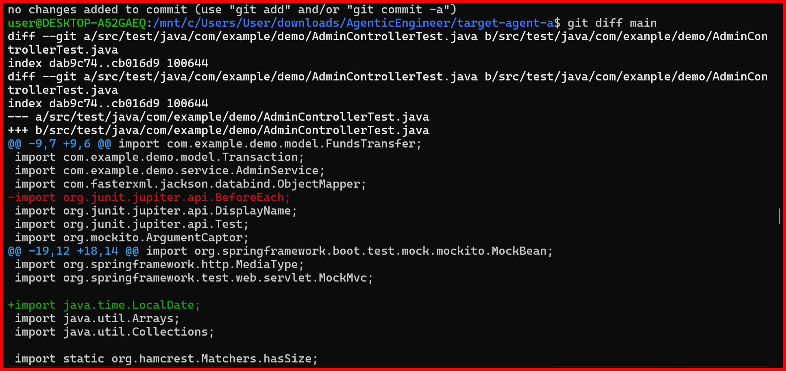
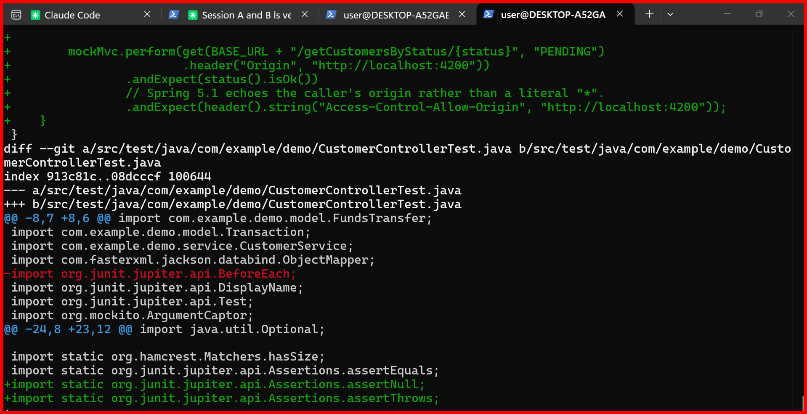

## Session B

**Branch name:** feature/agent-b  
**Worktree directory:** target-agent-b

**Task:**  
Update README.md with documentation describing the parallel multi-agent workflow, including worktree setup, agent responsibilities, container execution, and merge workflow.

**Files or folders the agent may write to:**
- `README.md`

**Files or folders the agent may read but not write to:**
- `src/main/java/**`
- `src/test/java/**`
- `pom.xml`
- Existing application source files

**Commands the agent may run:**
- `git status`
- `git diff`
- `git log`
- `git branch`
- `mvn test` (optional verification only)

**Definition of done:**
- README.md contains clear documentation of the parallel agent workflow.
- Documentation explains worktree creation, container execution, and merge process.
- Changes are committed with a meaningful commit message.

**From the root of your main target Codebase, create worktree for session B.:**

Confirm the Repository is on the main branch and ensures that both worktrees branch off the same clean baseline,
which makes the final merge straightforward.

```bash
git checkout main
git pull
git worktree add ../target-agent-b -b feature/agent-b
```

**Verify the worktrees :**

```bash
git worktree list
```

```bash
user@DESKTOP-A52GAEQ:/mnt/c/Users/User/downloads/AgenticEngineer/BackendCapstone-BankingWeb-app$ git checkout main   # (staged files omitted)
Already on 'main'
Your branch is up to date with 'origin/main'.
user@DESKTOP-A52GAEQ:/mnt/c/Users/User/downloads/AgenticEngineer/BackendCapstone-BankingWeb-app$ git pull
Already up to date.
user@DESKTOP-A52GAEQ:/mnt/c/Users/User/downloads/AgenticEngineer/BackendCapstone-BankingWeb-app$ git worktree add ../target-agent-b -b feature/agent-b
Preparing worktree (new branch 'feature/agent-b')
Updating files: 100% (219/219), done.
HEAD is now at 196bf7b docs: define parallel agent session tasks
user@DESKTOP-A52GAEQ:/mnt/c/Users/User/downloads/AgenticEngineer/BackendCapstone-BankingWeb-app$
user@DESKTOP-A52GAEQ:/mnt/c/Users/User/downloads/AgenticEngineer/BackendCapstone-BankingWeb-app$ git worktree list
/mnt/c/Users/User/downloads/AgenticEngineer/BackendCapstone-BankingWeb-app 196bf7b [main]
/mnt/c/Users/User/downloads/AgenticEngineer/target-agent-a                 196bf7b [feature/agent-a]
/mnt/c/Users/User/downloads/AgenticEngineer/target-agent-b                 196bf7b [feature/agent-b]
user@DESKTOP-A52GAEQ:/mnt/c/Users/User/downloads/AgenticEngineer/BackendCapstone-BankingWeb-app$
```

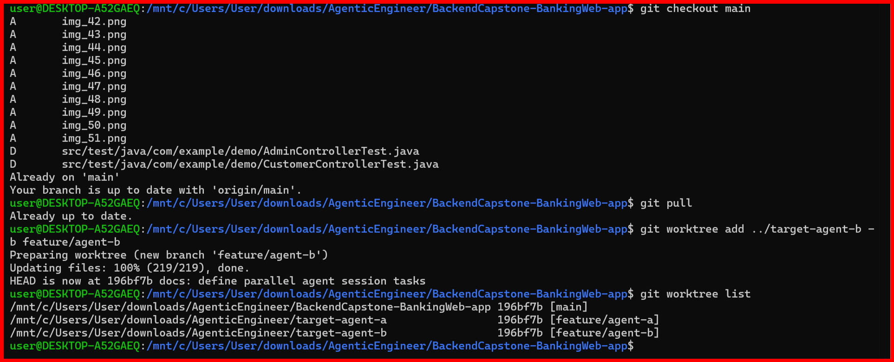

verify worktree is on the correct branch:

```bash
cd ../target-agent-b
ls
git branch
```

```bash
user@DESKTOP-A52GAEQ:/mnt/c/Users/User/downloads/AgenticEngineer/BackendCapstone-BankingWeb-app$ git worktree list
/mnt/c/Users/User/downloads/AgenticEngineer/BackendCapstone-BankingWeb-app 196bf7b [main]
/mnt/c/Users/User/downloads/AgenticEngineer/target-agent-a                 196bf7b [feature/agent-a]
/mnt/c/Users/User/downloads/AgenticEngineer/target-agent-b                 196bf7b [feature/agent-b]
user@DESKTOP-A52GAEQ:/mnt/c/Users/User/downloads/AgenticEngineer/BackendCapstone-BankingWeb-app$ cd ../target-agent-b
user@DESKTOP-A52GAEQ:/mnt/c/Users/User/downloads/AgenticEngineer/target-agent-b$ ls
CLAUDE.md             img_10.png  img_20.png  img_30.png  img_40.png                     pom.xml
Dockerfile            img_11.png  img_21.png  img_31.png  img_41.png                     session_tasks.md
README.md             img_12.png  img_22.png  img_32.png  img_5.png                      settings.json
docker-entrypoint.sh  img_13.png  img_23.png  img_33.png  img_6.png                      setup.md
docs                  img_14.png  img_24.png  img_34.png  img_7.png                      src
egress-smoke.txt      img_15.png  img_25.png  img_35.png  img_8.png                      statusline.sh
eval                  img_16.png  img_26.png  img_36.png  img_9.png                      summary.txt
handoff-phase-one.md  img_17.png  img_27.png  img_37.png  lesson-4-lab-submission.patch
img.png               img_18.png  img_28.png  img_38.png  mcp
img35.png             img_19.png  img_29.png  img_39.png  mvnw
img_1.png             img_2.png   img_3.png   img_4.png   mvnw.cmd
user@DESKTOP-A52GAEQ:/mnt/c/Users/User/downloads/AgenticEngineer/target-agent-b$ git branch
+ feature/agent-a
  feature/agent-a-test
  feature/agent-a1
* feature/agent-b
+ main
  setup-review-fixes
user@DESKTOP-A52GAEQ:/mnt/c/Users/User/downloads/AgenticEngineer/target-agent-b$
```

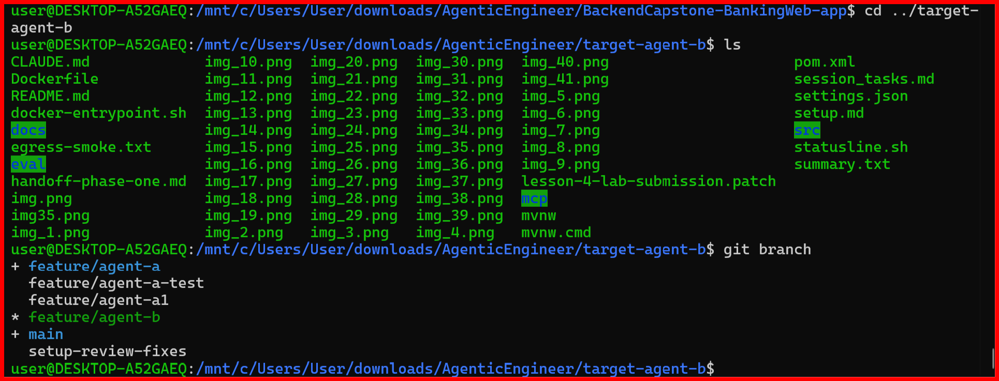

Launch the container in the terminal 2:

docker run -it --rm \
-v "${PWD}:/workspace" \
-v "claude-auth:/claude-auth" \
backend-banking-capstone-app

and use Claude inside container to execute the task
```bash
user@DESKTOP-A52GAEQ:/mnt/c/Users/User/downloads/AgenticEngineer/target-agent-b$ docker run -it --rm -v "${PWD
}:/workspace" -v "claude-auth:/claude-auth" backend-banking-capstone-app
Slack MCP not configured (SLACK_BOT_TOKEN/SLACK_TEAM_ID unset); skipping.
Added stdio MCP server gmail with command: node /usr/local/lib/node_modules/@gongrzhe/server-gmail-autoauth-mcp/dist/index.js to local config
File modified: /root/.claude.json [project: /workspace]
 * Starting MariaDB database server mariadbd                                                           [ OK ]
Database ready: db_world
ai-course:/workspace# ls
CLAUDE.md             img_10.png  img_20.png  img_30.png  img_40.png                     pom.xml
Dockerfile            img_11.png  img_21.png  img_31.png  img_41.png                     session_tasks.md
README.md             img_12.png  img_22.png  img_32.png  img_5.png                      settings.json
docker-entrypoint.sh  img_13.png  img_23.png  img_33.png  img_6.png                      setup.md
docs                  img_14.png  img_24.png  img_34.png  img_7.png                      src
egress-smoke.txt      img_15.png  img_25.png  img_35.png  img_8.png                      statusline.sh
eval                  img_16.png  img_26.png  img_36.png  img_9.png                      summary.txt
handoff-phase-one.md  img_17.png  img_27.png  img_37.png  lesson-4-lab-submission.patch
img.png               img_18.png  img_28.png  img_38.png  mcp
img35.png             img_19.png  img_29.png  img_39.png  mvnw
img_1.png             img_2.png   img_3.png   img_4.png   mvnw.cmd
ai-course:/workspace#
```
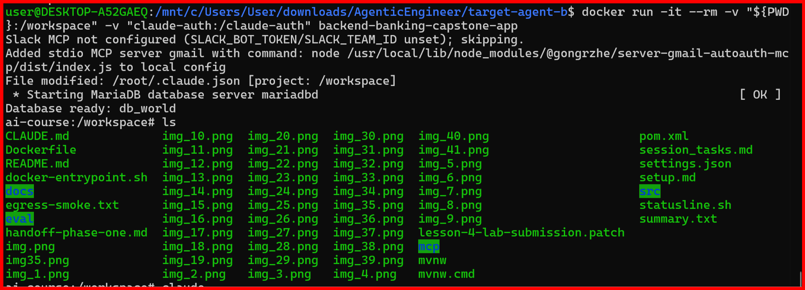

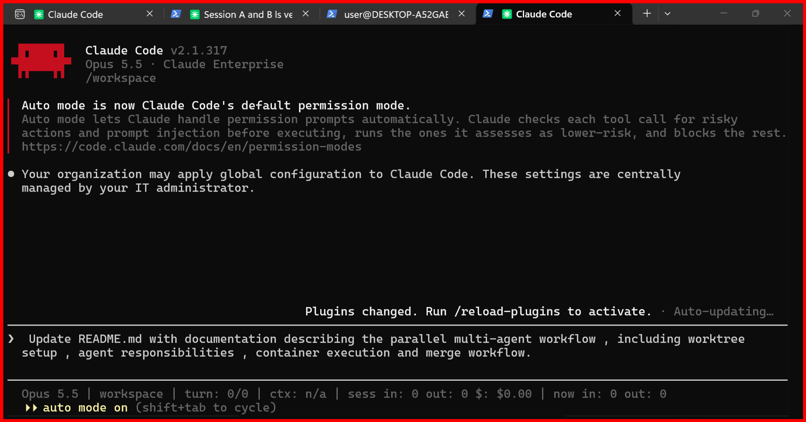

Actual Result:

```bash
 
Splicing the rewritten workflow section into README.md now.

  Ran 1 shell command

I rewrote the "Parallel Multi-Agent Workflow" section of README.md (now README.md:25–287). Nothing outside that section changed.

Context boundary check (required by CLAUDE.md)
- Goal: document the parallel multi-agent workflow in README.md: worktree setup, agent responsibilities, container execution and the merge workflow.
- Rules in effect: "Context Boundary Procedure", "Memory Configuration", "Write policy", "Stale memory policy", "Scope verification" and "Memory Scope Policy" from /workspace/CLAUDE.md.
- Rules no longer in effect: none.
- File worked on: README.md.
- .memory/SCOPE.md names BankingProject_Backend at /workspace, which matches this project.
- The project memory entries don't say which agent or task they apply to, so I didn't rely on them. I took the facts from pom.xml, the Dockerfile and docker-entrypoint.sh instead.
- No memory entry is past its review date; the earliest is 2026-11-23.
```

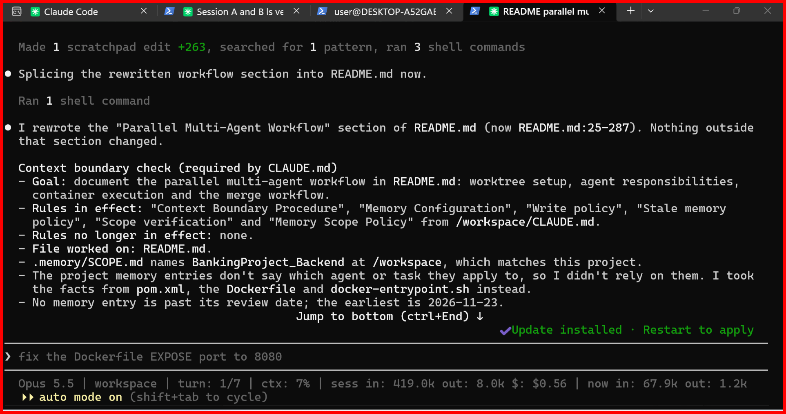

After agents finish, use git status and git diff main commands in order to inspect each worktree separately against main.

```bash
user@DESKTOP-A52GAEQ:/mnt/c/Users/User/downloads/AgenticEngineer/target-agent-b$ git status
On branch feature/agent-b
Changes not staged for commit:
  (use "git add <file>..." to update what will be committed)
  (use "git restore <file>..." to discard changes in working directory)
        modified:   README.md

no changes added to commit (use "git add" and/or "git commit -a")
user@DESKTOP-A52GAEQ:/mnt/c/Users/User/downloads/AgenticEngineer/target-agent-b$  git diff main
diff --git a/README.md b/README.md
index 7fb5f09..5c1e7d8 100644
--- a/README.md
+++ b/README.md
@@ -24,125 +24,266 @@ The backend follows a layered Spring Boot architecture, with controllers respons

 ## Parallel Multi-Agent Workflow

-This repository supports running **two Claude Code agents in parallel** on the same codebase. Each agent works in its own **Git worktree** (a separate checkout on its own branch) and runs inside its own **Docker container**. Each agent's changes stay isolated until a human reviews and merges them into `main`.
+This repository supports running **two Claude Code agents in parallel** on the same codebase. Each agent works in its own **Git worktree** (a separate checkout on its own branch) and runs inside its own **Docker container**. Changes stay isolated on each agent's branch until a human reviews them and merges them into `main`.
```

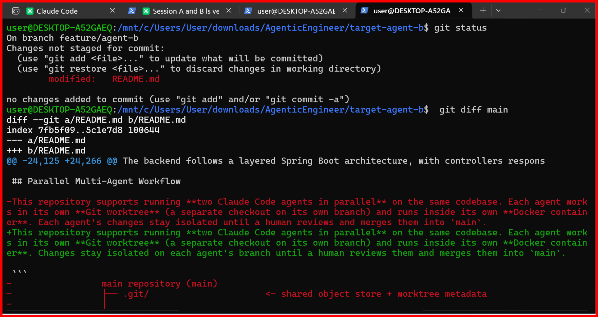

## Why These Tasks Can Run in Parallel

The two sessions were intentionally assigned non-overlapping write scopes.

- **Session A** writes only to:
  - `src/test/java/com/example/demo/AdminControllerTest.java`
  - `src/test/java/com/example/demo/CustomerControllerTest.java`
- **Session B** writes only to:
  - `README.md`

Both sessions are allowed to read the production source code, `pom.xml`, and other existing application files, but neither session is permitted to modify them. Keeping these shared resources read-only ensures both agents work from the same codebase without introducing conflicting changes.

Because each session writes to a different part of the repository, they cannot overwrite each other's work or create file-level merge conflicts during development.

If both sessions were allowed to modify the same files (for example, `README.md`, `pom.xml`, or the controller source files), concurrent edits could result in merge conflicts, accidental overwrites, or difficulty determining which changes belong to each task. Restricting each session to separate write scopes keeps the work independent and makes review and merging straightforward.

## Shared Files Excluded From Write Scope

Both sessions were allowed to read shared files such as:

- `src/main/java/**`
- `pom.xml`
- Existing application source files

These files were excluded from write access because parallel changes to production code or shared configuration could create conflicts or unintended changes. Keeping them read-only allowed both agents to work independently and made merging safer.

## Evaluation and Merge Verification

Each agent branch was reviewed independently against `main` before merging.

### Session A

```bash
cd ../target-agent-a
git status
git diff main
```

```bash
user@DESKTOP-A52GAEQ:/mnt/c/Users/User/downloads/AgenticEngineer/target-agent-a$ git status
On branch feature/agent-a
Changes not staged for commit:
  (use "git add <file>..." to update what will be committed)
  (use "git restore <file>..." to discard changes in working directory)
        modified:   src/test/java/com/example/demo/AdminControllerTest.java
        modified:   src/test/java/com/example/demo/CustomerControllerTest.java

no changes added to commit (use "git add" and/or "git commit -a")
user@DESKTOP-A52GAEQ:/mnt/c/Users/User/downloads/AgenticEngineer/target-agent-a$ git diff main
diff --git a/src/test/java/com/example/demo/AdminControllerTest.java b/src/test/java/com/example/demo/AdminControllerTest.java
index dab9c74..cb016d9 100644
diff --git a/src/test/java/com/example/demo/AdminControllerTest.java b/src/test/java/com/example/demo/AdminCon
trollerTest.java
index dab9c74..cb016d9 100644
--- a/src/test/java/com/example/demo/AdminControllerTest.java
+++ b/src/test/java/com/example/demo/AdminControllerTest.java
@@ -9,7 +9,6 @@ import com.example.demo.model.FundsTransfer;
 import com.example.demo.model.Transaction;
 import com.example.demo.service.AdminService;
 import com.fasterxml.jackson.databind.ObjectMapper;
-import org.junit.jupiter.api.BeforeEach;
 import org.junit.jupiter.api.DisplayName;
 import org.junit.jupiter.api.Test;
 import org.mockito.ArgumentCaptor;
@@ -19,12 +18,14 @@ import org.springframework.boot.test.mock.mockito.MockBean;
 import org.springframework.http.MediaType;
 import org.springframework.test.web.servlet.MockMvc;

+import java.time.LocalDate;
 import java.util.Arrays;
 import java.util.Collections;

 import static org.hamcrest.Matchers.hasSize;
 import static org.junit.jupiter.api.Assertions.assertEquals;
 import static org.junit.jupiter.api.Assertions.assertNull;
+import static org.junit.jupiter.api.Assertions.assertThrows;
 import static org.mockito.ArgumentMatchers.any;
 import static org.mockito.ArgumentMatchers.eq;
```

```bash
diff --git a/src/test/java/com/example/demo/CustomerControllerTest.java b/src/test/java/com/example/demo/CustomerControllerTest.java
index 913c81c..08dcccf 100644
--- a/src/test/java/com/example/demo/CustomerControllerTest.java
+++ b/src/test/java/com/example/demo/CustomerControllerTest.java
@@ -8,7 +8,6 @@ import com.example.demo.model.FundsTransfer;
 import com.example.demo.model.Transaction;
 import com.example.demo.service.CustomerService;
 import com.fasterxml.jackson.databind.ObjectMapper;
-import org.junit.jupiter.api.BeforeEach;
 import org.junit.jupiter.api.DisplayName;
 import org.junit.jupiter.api.Test;
 import org.mockito.ArgumentCaptor;
@@ -24,8 +23,12 @@ import java.util.Optional;

 import static org.hamcrest.Matchers.hasSize;
 import static org.junit.jupiter.api.Assertions.assertEquals;
+import static org.junit.jupiter.api.Assertions.assertNull;
+import static org.junit.jupiter.api.Assertions.assertThrows;
```


**Correctness and usefulness:**  
The agent modified the existing `AdminControllerTest.java` and `CustomerControllerTest.java`. Test counts increased from 22 to 26 (`AdminControllerTest`) and from 27 to 29 (`CustomerControllerTest`), and all 55 pass (`mvn test`, exit code 0). The tests cover the assigned controller behavior, mocked service interactions, HTTP responses, and response data.

**Quality finding:**  
Two of the new tests use `assertThrows` to check error paths: `serviceException_propagates` ("Service exception is not swallowed by the controller (no @ControllerAdvice yet)") and `withdrawAccount_serviceThrows` ("service failure (e.g. insufficient funds) is not swallowed"). They show that the controllers have no error handling: a service failure such as insufficient funds propagates as an exception instead of returning an HTTP 4xx/5xx response. The tests correctly document current behavior, so the branch was approved. The finding is recorded as a production gap: adding a `@ControllerAdvice` with proper error responses should be a separate, scoped task, because it would change production source code, which is outside Session A's write scope.

**Scope adherence:**  
`git diff main` showed only:
- `src/test/java/com/example/demo/AdminControllerTest.java`
- `src/test/java/com/example/demo/CustomerControllerTest.java`

No production source, README, configuration, or unrelated test files were modified.

**Production appropriateness:**  
The changes add automated controller test coverage without modifying application behavior or production source code. The tests passed successfully, so the changes were considered appropriate to merge.

**Definition of done:**  
All assigned test classes were created, mocking was used, the required endpoint behavior was tested, tests passed, and the branch was committed.

**Merge decision:** Approved.

**Reason:** The diff matched the assigned file-level scope and the successful test execution demonstrated that the required controller test coverage was functional.

### Session B

```bash
cd ../target-agent-b
git status
git diff main
```
```bash
user@DESKTOP-A52GAEQ:/mnt/c/Users/User/downloads/AgenticEngineer/target-agent-b$ git status
On branch feature/agent-b
Changes not staged for commit:
  (use "git add <file>..." to update what will be committed)
  (use "git restore <file>..." to discard changes in working directory)
        modified:   README.md

no changes added to commit (use "git add" and/or "git commit -a")
user@DESKTOP-A52GAEQ:/mnt/c/Users/User/downloads/AgenticEngineer/target-agent-b$  git diff main
diff --git a/README.md b/README.md
index 7fb5f09..5c1e7d8 100644
--- a/README.md
+++ b/README.md
@@ -24,125 +24,266 @@ The backend follows a layered Spring Boot architecture, with controllers respons

 ## Parallel Multi-Agent Workflow

-This repository supports running **two Claude Code agents in parallel** on the same codebase. Each agent works in its own **Git worktree** (a separate checkout on its own branch) and runs inside its own **Docker container**. Each agent's changes stay isolated until a human reviews and merges them into `main`.
+This repository supports running **two Claude Code agents in parallel** on the same codebase. Each agent works in its own **Git worktree** (a separate checkout on its own branch) and runs inside its own **Docker container**. Changes stay isolated on each agent's branch until a human reviews them and merges them into `main`.
```


**Correctness and usefulness:**  
The agent updated `README.md` with documentation covering the parallel workflow, worktree setup, container execution, agent responsibilities, and merge process.

**Scope adherence:**  
`git diff main ` showed only: `README.md`

No source, test, configuration, or other files were modified.

**Production appropriateness:**  
The change is documentation-only and does not alter application behavior. The documentation is appropriate for explaining the demonstrated workflow.

**Definition of done:**  
The README contains the required workflow documentation and the branch was committed with a meaningful commit message.

**Merge decision:** Approved.

**Reason:** The diff contained only the assigned README change and satisfied the Session B definition of done.

### Merge

```bash
cd ../BackendCapstone-BankingWeb-app
git merge feature/agent-a
git merge feature/agent-b
git log --oneline -5
```
The merge was performed only after reviewing each branch with `git diff main`. The merge commands were executed for both feature branches, followed by git log --oneline -5 and git status to verify the resulting repository state.

```bash
user@DESKTOP-A52GAEQ:/mnt/c/Users/User/downloads/AgenticEngineer/BackendCapstone-BankingWeb-app$ git merge --no-ff feature/agent-a -m "Merge branch 'feature/agent-a'"
Merge made by the 'ort' strategy.
 src/test/java/com/example/demo/AdminControllerTest.java    | 531 ++++++++++++++++++++++++++-----------------
 src/test/java/com/example/demo/CustomerControllerTest.java | 516 +++++++++++++++++++++++------------------
 2 files changed, 618 insertions(+), 429 deletions(-)
user@DESKTOP-A52GAEQ:/mnt/c/Users/User/downloads/AgenticEngineer/BackendCapstone-BankingWeb-app$ git merge --no-ff feature/agent-b -m "Merge branch 'feature/agent-b'"
Merge made by the 'ort' strategy.
 README.md | 257 +++++++++++++++++++++++++++++++++++++++++++++++++++++++++++++++++++++++---------------------
 1 file changed, 199 insertions(+), 58 deletions(-)
user@DESKTOP-A52GAEQ:/mnt/c/Users/User/downloads/AgenticEngineer/BackendCapstone-BankingWeb-app$ git log --oneline --graph -6
*   9b5779a (HEAD -> main) Merge branch 'feature/agent-b'
|\
| * cb38525 (feature/agent-b) docs: document parallel workflow per Session B contract
* |   d53615f Merge branch 'feature/agent-a'
|\ \
| |/
|/|
| * 529a06f (feature/agent-a) test: add controller test cases per Session A contract
|/
* 196bf7b (origin/main, origin/HEAD) docs: define parallel agent session tasks
* 290ad52 docs: review comments fixed : add measured Runs 022/023 with cycle time, review latency and cost
user@DESKTOP-A52GAEQ:/mnt/c/Users/User/downloads/AgenticEngineer/BackendCapstone-BankingWeb-app$ git log --oneline -5
9b5779a (HEAD -> main) Merge branch 'feature/agent-b'
d53615f Merge branch 'feature/agent-a'
cb38525 (feature/agent-b) docs: document parallel workflow per Session B contract
529a06f (feature/agent-a) test: add controller test cases per Session A contract
196bf7b (origin/main, origin/HEAD) docs: define parallel agent session tasks
user@DESKTOP-A52GAEQ:/mnt/c/Users/User/downloads/AgenticEngineer/BackendCapstone-BankingWeb-app$
```

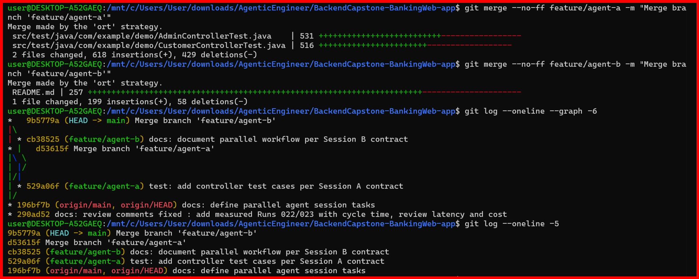

## Final Cleanup

```bash
git worktree remove ../target-agent-a
git worktree remove ../target-agent-b

git worktree list

git status
```

Expected result:

- Only the main worktree remains.
- `git status` reports a clean working tree.

Screenshot:

```bash
user@DESKTOP-A52GAEQ:/mnt/c/Users/User/downloads/AgenticEngineer/BackendCapstone-BankingWeb-app$ git worktree remove ../target-agent-a
user@DESKTOP-A52GAEQ:/mnt/c/Users/User/downloads/AgenticEngineer/BackendCapstone-BankingWeb-app$ git worktree remove ../target-agent-b
user@DESKTOP-A52GAEQ:/mnt/c/Users/User/downloads/AgenticEngineer/BackendCapstone-BankingWeb-app$ git worktree list
/mnt/c/Users/User/downloads/AgenticEngineer/BackendCapstone-BankingWeb-app 9b5779a [main]
user@DESKTOP-A52GAEQ:/mnt/c/Users/User/downloads/AgenticEngineer/BackendCapstone-BankingWeb-app$
User@DESKTOP-A52GAEQ MINGW64 ~/downloads/AgenticEngineer/BackendCapstone-BankingWeb-app (main)
$ git status
On branch main
Your branch is up to date with 'origin/main'.

nothing to commit, working tree clean
```
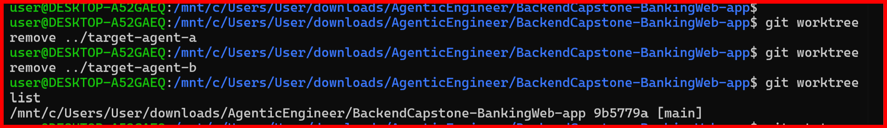

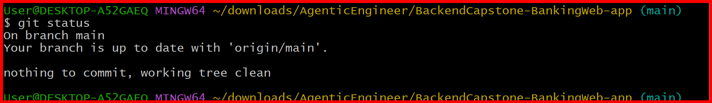

## Reflection

### Q1. What did you learn about defining parallel agent tasks?

This run showed that parallel tasks need both separate responsibilities and explicit file-level write boundaries. Session A focused on controller tests while Session B focused on README documentation, so the two tasks could be executed independently. Defining the expected output files also made post-run scope verification easier.

### Q2. How did the task definitions affect agent behavior?

Session A was directed to create only the two controller test classes, while Session B was directed to modify only README.md. This gave each agent a clear target and prevented the tasks from competing for the same files.

### Q3. What happened with merge conflicts, and why?

The branches merged without a file-level conflict because the write scopes were separated before the agents started. Session A modified the assigned test files and Session B modified README.md. The clean merge was therefore a result of deliberate task decomposition rather than relying on the agents to avoid each other's files.

### Q4. What judgment call required human oversight?

The worktree and container setup could verify branch and filesystem isolation, but it could not determine whether the generated tests provided meaningful coverage or whether the README documentation was sufficiently useful and production-appropriate. Those aspects required human review of the actual diffs and test results.

### Q5. How did the scope definition affect the merge outcome?

The non-overlapping scopes made the branches independently reviewable and reduced the possibility of conflicting edits. The Session A test files and Session B README change could be merged without competing modifications to the same file.

### Q6. What would you change in the next run?

**What this run showed:**
- **No scope drift:** each `git diff main` contained only the assigned files (two test files for Session A, `README.md` for Session B).
- **A vague instruction produced no work:** an earlier Session A attempt told the agent to "update" the test classes in an interactive `claude` session. It made no changes, because the tests already existed and the instruction gave no target, and `git diff main` was empty.
- **An out-of-scope problem was found but correctly not fixed:** Session A's new `assertThrows` tests showed the controllers have no `@ControllerAdvice`, so service failures propagate as exceptions. The agent documented this with tests instead of editing production code, which the write scope forbids.
- **Neither agent checked its own scope:** scope adherence was confirmed only by my `git diff main` review, not by the agents.

**Preventive changes (better task scoping, written into `session_tasks.md` before the run):**
1. Make the definition of done measurable for existing files: "add at least N new test cases covering endpoints or error paths not yet tested", not "create test classes".
2. Require each agent to run `git status` and `git diff main --stat` before finishing, and to report that only its allowed files changed.
3. Turn findings outside the write scope, such as the missing `@ControllerAdvice`, into a separate, scoped task rather than leaving them in a test comment.

**Corrective prompts (used during a session, only when a problem is observed):**
- When Session A made no changes, the fix was a corrective prompt in non-interactive mode: `claude -p "... Add new Mockito test cases ... for endpoints or cases not yet covered ..."`. This produced `529a06f`.
- If an agent edits a file outside its scope: "Revert changes to `<file>` with `git restore <file>`; it is outside your write scope."

Scoping fixes prevent a whole class of problems before the run (unclear targets, unchecked scope), while corrective prompts handle a specific problem seen during a session. This run needed one of each.