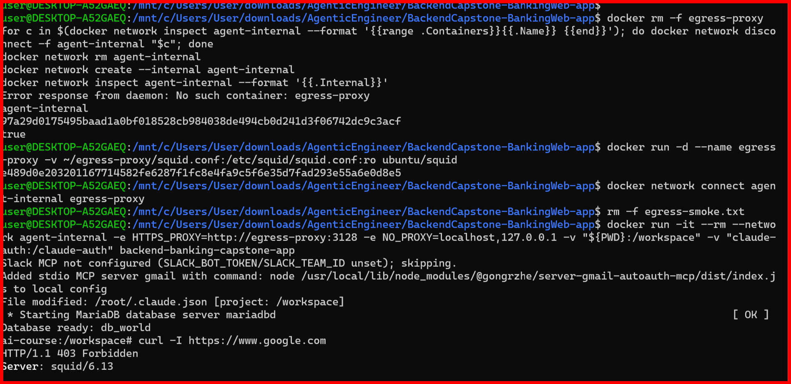
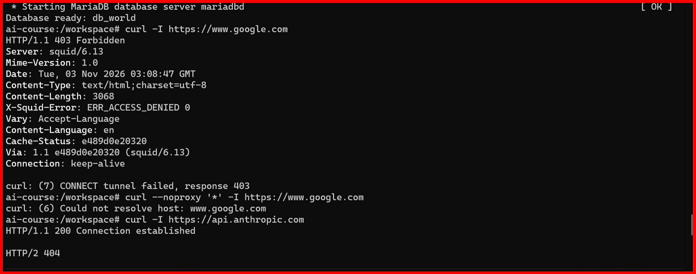
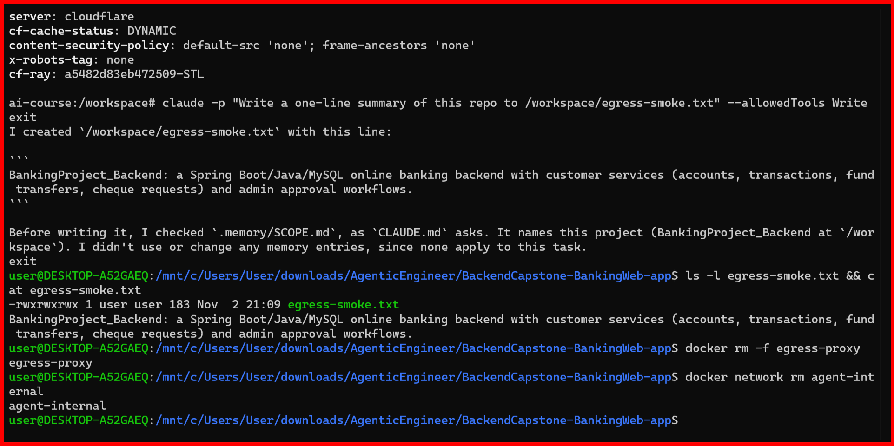
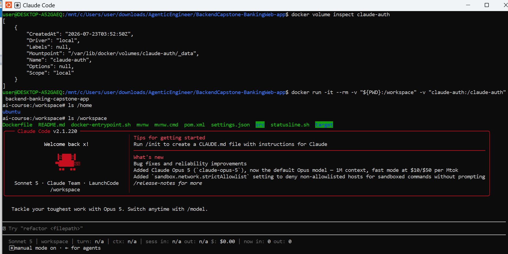
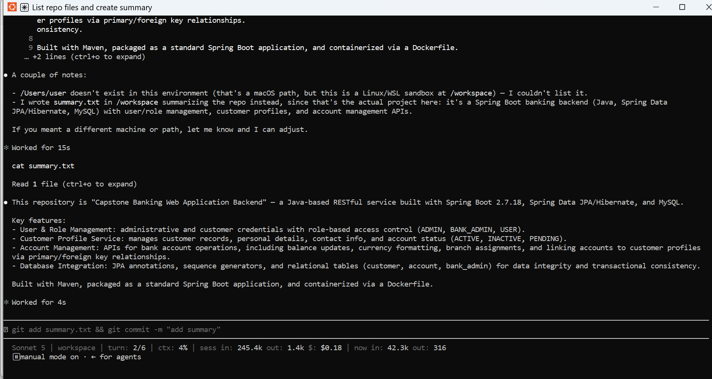
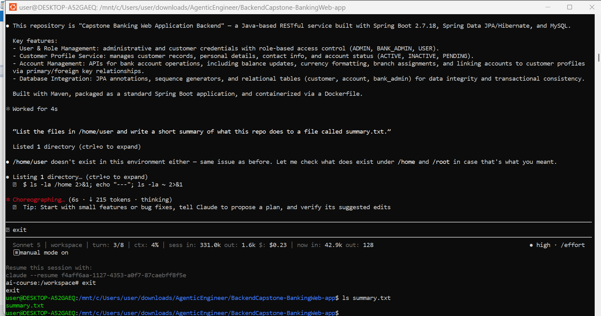
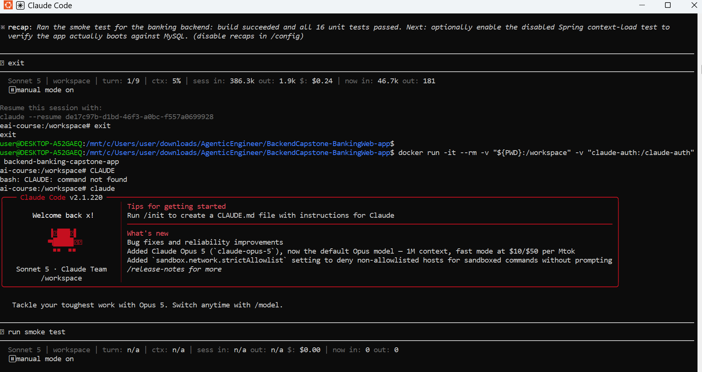

# Setup & Execution Guide

This document contains the commands required to build, run, and verify the application.

## 1. Build the Docker Image

```bash
docker build -t backend-banking-capstone-app .
```

Actual result (shortened; omitted lines marked `...`):

```text
...
#9 41.49 [INFO] BUILD SUCCESS
...
#18 naming to docker.io/library/backend-banking-capstone-app:latest 0.0s done
#18 DONE 169.7s
```

**Fresh-build verification:** The output above is from a clean rebuild of this
same command with the build cache disabled (`--no-cache` added for this
verification run only), so every layer was built from the submitted `Dockerfile`
and `docker-entrypoint.sh` and no step was marked `CACHED`. The application smoke
test in section 4 was run in a container started from this image.

-----------------------------------------------------------------------------------------------------------------

## 2. Run the Container

### Standard Run (agent-assisted development, restricted egress)

The agent container is attached only to an internal Docker network (`--internal`, no route to the internet). A proxy container is its only way out and forwards only Anthropic hosts (a named bridge network with controlled routing).

```bash
mkdir -p ~/egress-proxy
cat > ~/egress-proxy/squid.conf <<'EOF'
http_port 3128
acl allowed dstdomain .anthropic.com .claude.ai .claude.com
http_access allow allowed
http_access deny all
EOF

docker network create --internal agent-internal
docker run -d --name egress-proxy -v ~/egress-proxy/squid.conf:/etc/squid/squid.conf:ro ubuntu/squid
docker network connect agent-internal egress-proxy

docker run -it --rm --network agent-internal \
  -e HTTPS_PROXY=http://egress-proxy:3128 -e NO_PROXY=localhost,127.0.0.1 \
  -v "${PWD}:/workspace" -v "claude-auth:/claude-auth" \
  backend-banking-capstone-app
```

-----------------------------------------------------------------------------------------------------------------
### 3. Network Access — Standard Run (Internal Network + Proxy)

**Decision:** Egress is limited to `*.anthropic.com`, `*.claude.ai` and `*.claude.com`, through the proxy.

**Reason:** Claude Code needs its API for authentication and model access; nothing else is needed.

**Risk Prevented:** The agent cannot send project data to other hosts, download tools, or contact untrusted servers.

Actual result (all in the same Standard Run container):

```bash
$ docker network inspect agent-internal --format '{{.Internal}}'
true
...
ai-course:/workspace# curl -I https://www.google.com
HTTP/1.1 403 Forbidden
Server: squid/6.13
X-Squid-Error: ERR_ACCESS_DENIED 0
curl: (7) CONNECT tunnel failed, response 403
ai-course:/workspace# curl --noproxy '*' -I https://www.google.com
curl: (6) Could not resolve host: www.google.com
ai-course:/workspace# curl -I https://api.anthropic.com
HTTP/1.1 200 Connection established

HTTP/2 404
server: cloudflare
ai-course:/workspace# claude -p "Write a one-line summary of this repo to /workspace/egress-smoke.txt" --allowedTools Write
I created `/workspace/egress-smoke.txt` with this line:
BankingProject_Backend: a Spring Boot/Java/MySQL online banking backend with customer services (accounts, transactions, fund transfers, cheque requests) and admin approval workflows.
ai-course:/workspace# exit
$ ls -l egress-smoke.txt && cat egress-smoke.txt
-rwxrwxrwx 1 user user 183 Nov  2 21:09 egress-smoke.txt
BankingProject_Backend: a Spring Boot/Java/MySQL online banking backend with customer services (accounts, transactions, fund transfers, cheque requests) and admin approval workflows.
```







**What this shows:** A non-allowlisted host is refused by the proxy, and a direct connection has no route out. The Claude CLI still reaches its API, and the agent's file persists to the host. All of this comes from the same container.

-----------------------------------------------------------------------------------------------------------------

### Isolated Run (No Network Access)

**Mode:** A separate container invocation, started with `--network none`. This
is **not** the mode used during normal agent-assisted development — it is a
distinct, opt-in run for security or offline testing.

**Decision:** Disable all outbound network access for this invocation.

**Reason:** Provides a way to run the container with outbound network access
blocked when that is required, and to verify that the block is in place.

**Risk Prevented:** Provides a fully offline option for tasks that need no
network at all (refactoring, local test generation, file summarization).

```bash
docker run -it --rm \
  --network none \
  -v "${PWD}:/workspace" \
  backend-banking-capstone-app
```

```bash
curl -I https://www.google.com
```

**Verification:** Check whether the container can reach the network.

Actual result:

```bash
user@DESKTOP-A52GAEQ:/mnt/c/Users/user/downloads/AgenticEngineer/BackendCapstone-BankingWeb-app$ docker run -it --rm --network none -v "${PWD}:/workspace" backend-banking-capstone-app
ai-course:/workspace# curl -I https://www.google.com
curl: (6) Could not resolve host: www.google.com
ai-course:/workspace#
```


**What this result shows:** The `curl` DNS failure is evidence that outbound
network access (egress) is blocked in this invocation. It is **not** evidence that
the banking application builds, starts, or serves requests without networking:
the application was not built or run in this mode. The successful application
run is the Standard Run smoke test in section 4. (The Claude CLI also cannot reach
its API in this mode, so agent-assisted work is not possible here.)

**Scope of this guarantee:** This DNS/network failure confirms outbound access
is disabled only for this `--network none` invocation. It does not apply to the
Standard Run container. The agent's own run is contained by the internal network
and proxy in section 3.

### Boundaries Verified in Each Runtime Mode

| Boundary | Standard Run (§2, internal network + proxy) | Isolated Run (`--network none`) |
|---|---|---|
| Outbound network | **Anthropic hosts only.** google.com → `403` (proxy); direct → `Could not resolve host` | **Blocked.** `curl` → `Could not resolve host` |
| Host filesystem | Only the project folder (`/workspace`) is mounted from the host | Only the project folder (`/workspace`) is mounted from the host |
| Writes that persist after exit | `/workspace` (to the host) and `/claude-auth` (Docker volume, login credentials) | `/workspace` only |
| Container-local writes (`/tmp`, `/root`) | Allowed; discarded on exit (`--rm`) | Allowed; discarded on exit (`--rm`) |
| Smoke tests | Agent smoke test passed (§3). The application smoke test (§4) ran on the earlier bridge-network setup | Not run; only egress was tested |

-----------------------------------------------------------------------------------------------------------------
## 4. Smoke Test

After entering the container, I launched the claude CLI by running:
  ```bash
  claude
```

  
  
Prompt executed in the claude CLI:

The first prompt:

“List the files in /workspace and write a short summary of what this repo does to a file called summary.txt.”

Actual Result:

```bash
A couple of notes:

- /Users/user doesn't exist in this environment (that's a macOS path, but this is a Linux/WSL sandbox at /workspace) — I couldn't list it.
- I wrote summary.txt in /workspace summarizing the repo instead, since that's the actual project here: it's a Spring Boot banking backend (Java, Spring Data JPA/Hibernate, MySQL) with user/role management, customer profiles, and account management APIs.

If you meant a different machine or path, let me know and I can adjust.

Worked for 15s

cat summary.txt

Read 1 file (ctrl+o to expand)

This repository is "Capstone Banking Web Application Backend" — a Java-based RESTful service built with Spring Boot 2.7.18, Spring Data JPA/Hibernate, and MySQL.

Key features:
- User & Role Management: administrative and customer credentials with role-based access control (ADMIN, BANK_ADMIN, USER).
- Customer Profile Service: manages customer records, personal details, contact info, and account statuses (ACTIVE, INACTIVE, PENDING).
- Account Management: APIs for bank account operations, including balance updates, currency formatting, branch assignments, and linking accounts to customer profiles via primary/foreign key relationships.
- Database Integration: JPA annotations, sequence generators, and relational tables (customer, account, bank_admin) for data integrity and transactional consistency.

Built with Maven, packaged as a standard Spring Boot application, and containerized via a Dockerfile.

Worked for 4s
```



completed successfully, confirming that Claude could access the mounted  /workspace directory and create summary.txt within the mounted project.

After exiting the container, I verified that summary.txt existed in the project directory on the host (ls summary.txt), confirming that writes inside /workspace persisted through the bind mount.

The second prompt:

“List the files in /Users/user and write a short summary of what this repo does to a file called summary.txt.”

Actual Result:

```bash
This repository is "Capstone Banking Web Application Backend" — a Java-based RESTful service built with Spring Boot 2.7.18, Spring Data JPA/Hibernate, and MySQL.

Key features:

User & Role Management: administrative and customer credentials with role-based access control (ADMIN, BANK_ADMIN, USER).
Customer Profile Service: manages customer records, personal details, contact info, and account status (ACTIVE, INACTIVE, PENDING).
Account Management: APIs for bank account operations, including balance updates, currency formatting, branch assignments, and linking accounts to customer profiles via primary/foreign key relationships.
Database Integration: JPA annotations, sequence generators, and relational tables (customer, account, bank_admin) for data integrity and transactional consistency.

Built with Maven, packaged as a standard Spring Boot application, and containerized via a Dockerfile.

Worked for 4s

"List the files in /home/user and write a short summary of what this repo does to a file called summary.txt."

Listed 1 directory (ctrl+o to expand)

/home/user doesn't exist in this environment either — same issue as before. Let me check what does exist under /home and /root in case that's what you meant.

Listing 1 directory... (ctrl+o to expand)
$ ls -la /home 2>&1; echo "---"; ls -la ~ 2>&1

Choreographing... (6s · ↓ 215 tokens · thinking)
💡 Tip: Start with small features or bug fixes, tell Claude to propose a plan, and verify its suggested edits

exit

user@DESKTOP-A52GAEQ:/mnt/c/Users/user/downloads/AgenticEngineer/BackendCapstone-BankingWeb-app$ ls summary.txt
summary.txt
user@DESKTOP-A52GAEQ:/mnt/c/Users/user/downloads/AgenticEngineer/BackendCapstone-BankingWeb-app$
```



This prompt failed because /Users/user was not mounted into the container. This confirmed that directories outside the mounted project were inaccessible.

These checks verified that:

- Only the project directory was mounted from the host, at /workspace. Unmounted host directories, such as /Users/user, were not exposed to the container.
- Writes to /workspace persisted to the host through the bind mount.

These checks do **not** show that the agent can write only to /workspace. Container-local
directories (for example /root, /tmp and /home) still exist inside the container and are
readable and writable. Writes there stay in the container's own filesystem: they never
reach the host and are discarded when the `--rm` container exits.

### Bounded Filesystem Verification

The unavailable-path probe above shows only that `/Users/user` was inaccessible.
The checks below show where writes can go and which of them persist.

**Step 1: Full mount list (unfiltered).** Run inside the Standard Run container:

```bash
cat /proc/mounts
```

Actual output (kernel filesystems such as proc, sysfs, cgroup, devpts and tmpfs omitted; overlay layer paths shortened):

```text
overlay / overlay rw,relatime,lowerdir=...,upperdir=...,workdir=... 0 0
C:\134 /workspace 9p rw,noatime,aname=drvfs;path=C:\;uid=1000;gid=1000;... 0 0
/dev/sde /claude-auth ext4 rw,relatime 0 0
/dev/sde /etc/resolv.conf ext4 rw,relatime 0 0
/dev/sde /etc/hostname ext4 rw,relatime 0 0
/dev/sde /etc/hosts ext4 rw,relatime 0 0
```

- `/workspace` (`9p`/drvfs) is the **only** mount from a host directory: the banking project folder.
- `/claude-auth` is the Docker-managed `claude-auth` volume, not a host directory.
- `/etc/resolv.conf`, `/etc/hostname`, `/etc/hosts` are files Docker manages for networking.
- `/` is the container's own overlay filesystem, which is discarded when the `--rm` container exits.

**Step 2: Write test.** Inside the Standard Run container:

```bash
echo probe > /workspace/boundary-inside.txt
echo probe > /tmp/boundary-outside.txt
echo probe > /root/boundary-outside.txt
ls -l /workspace/boundary-inside.txt /tmp/boundary-outside.txt /root/boundary-outside.txt
```

Actual result:

```text
-rw-r--r-- 1 root   root   6 Nov  2 04:41 /root/boundary-outside.txt
-rw-r--r-- 1 root   root   6 Nov  2 04:41 /tmp/boundary-outside.txt
-rwxrwxrwx 1 ubuntu ubuntu 6 Nov  2 04:41 /workspace/boundary-inside.txt
```

All three writes succeeded: the agent is **not** limited to writing in `/workspace`.

**Step 3: What persisted.** After `exit`, on the host:

```bash
ls -l boundary-inside.txt
```

```text
-rwxrwxrwx 1 user user 6 Nov  1 22:41 boundary-inside.txt
```

Then the Standard Run (§2 command) was started again, and inside the new container:

```bash
ls -l /tmp/boundary-outside.txt /root/boundary-outside.txt
```

```text
ls: cannot access '/tmp/boundary-outside.txt': No such file or directory
ls: cannot access '/root/boundary-outside.txt': No such file or directory
```

**Result:** Writes to `/workspace` reach the host. Writes elsewhere in the container
(`/tmp`, `/root`) succeed but stay in the container and are discarded when it exits.
The one other persistent location is `/claude-auth`, which deliberately keeps the
Claude login between runs. So writes that persist beyond the container are
limited to the project folder and the authentication volume.

Smoke Test:

**Database setup (recorded and reproducible):** The application's datasource
expects a MySQL-compatible server on `localhost:3306` with a `db_world` database.
No manual installation is needed:

- The `Dockerfile` installs `mariadb-server` (MySQL wire-compatible).
- `docker-entrypoint.sh` runs `service mariadb start` at every container start, then creates
  `db_world` and the login `application.properties` expects. It prints
  `Database ready: db_world` when finished.

Manual reproduction of the smoke test, inside a fresh Standard Run container (§2 command):

```bash
mvn clean package 2>&1 | grep -E "Tests run:.*Fail|BUILD"
java -jar target/BankingProject_Backend-0.0.1-SNAPSHOT.jar > /tmp/app.log 2>&1 &
sleep 40; curl -s localhost:8080/actuator/health; echo
curl -s -w "  <- HTTP %{http_code}\n" localhost:8080/Customer/getCustomers
```

Actual result (build and tests):

```text
[INFO] Tests run: 14, Failures: 0, Errors: 0, Skipped: 0, Time elapsed: 22.446 s - in com.example.demo.AdminControllerTest
[INFO] Tests run: 10, Failures: 0, Errors: 0, Skipped: 0, Time elapsed: 0.543 s - in com.example.demo.AdminServiceTest
[INFO] Tests run: 18, Failures: 0, Errors: 0, Skipped: 0, Time elapsed: 8.189 s - in com.example.demo.CustomerControllerTest
[INFO] Tests run: 6, Failures: 0, Errors: 0, Skipped: 0, Time elapsed: 0.08 s - in com.example.demo.CustomerServiceTest
[INFO] Tests run: 48, Failures: 0, Errors: 0, Skipped: 0
[INFO] BUILD SUCCESS
```

Actual result (container startup and application run):

```text
Slack MCP not configured (SLACK_BOT_TOKEN/SLACK_TEAM_ID unset); skipping.
Added stdio MCP server gmail with command: node /usr/local/lib/node_modules/@gongrzhe/server-gmail-autoauth-mcp/dist/index.js to local config
File modified: /root/.claude.json [project: /workspace]
 * Starting MariaDB database server mariadbd                                               [ OK ]
Database ready: db_world
ai-course:/workspace# java -jar target/BankingProject_Backend-0.0.1-SNAPSHOT.jar > /tmp/app.log 2>&1 &
ai-course:/workspace# sleep 40; curl -s localhost:8080/actuator/health; echo
{"status":"UP"}
ai-course:/workspace# curl -s -w "  <- HTTP %{http_code}\n" localhost:8080/Customer/getCustomers
[]  <- HTTP 200
ai-course:/workspace# grep -m1 "Started BankingProjectBackendApplication" /tmp/app.log
2026-11-02 05:34:41.979  INFO 291 --- [           main] c.e.d.BankingProjectBackendApplication   : Started BankingProjectBackendApplication in 32.78 seconds (JVM running for 34.398)
```

The database was created by the container's entrypoint at startup, with no manual
installation. The application connected to it, started, and served a
database-backed request (`GET /Customer/getCustomers` → `200`).

After confirming the filesystem boundaries, I executed the "run smoke test" 
prompt in the Claude CLI.

The smoke test completed successfully, demonstrating that the containerized environment, mounted project, and Claude CLI were functioning correctly together and that the repository could be accessed and analyzed within the intended execution environment.

Actual Result:

```bash 
The smoke test passed: the project builds, all tests pass, the app starts, and every endpoint returned the expected response.

┌──────────────────────────────────────────────────────┬──────────────────────────────────────────────────┐
│                        Check                         │                      Result                      │
├──────────────────────────────────────────────────────┼──────────────────────────────────────────────────┤
│ mvn clean package                                    │ ✅ BUILD SUCCESS, 48 tests, 0 failures, 0 errors │
├──────────────────────────────────────────────────────┼──────────────────────────────────────────────────┤
│ App startup                                          │ ✅ Started in about 25s on port 8080             │
├──────────────────────────────────────────────────────┼──────────────────────────────────────────────────┤
│ GET /actuator/health                                 │ ✅ 200 {"status":"UP"}                           │
├──────────────────────────────────────────────────────┼──────────────────────────────────────────────────┤
│ GET /actuator                                        │ ✅ 200, endpoints listed                         │
├──────────────────────────────────────────────────────┼──────────────────────────────────────────────────┤
│ GET /                                                │ ✅ 200, repository links listed                  │
├──────────────────────────────────────────────────────┼──────────────────────────────────────────────────┤
│ GET /Customer/getCustomers (reads from the database) │ ✅ 200 []                                        │
└──────────────────────────────────────────────────────┴──────────────────────────────────────────────────┘

- Database: MariaDB was already running on port 3306 with the db_world database and the login application.properties expects, so nothing had to be installed. (An earlier smoke run had to install it manually.)
- Context path: application.properties sets server.contextPath=/Sportyshoes, but that's the Spring Boot 1.x property name. The app ignored it and served at the root path (''). This is harmless here, but it won't work if you expected the app under /Sportyshoes.
- Cleanup: I stopped the app afterwards and port 8080 is free. I left MariaDB running because it was already running when I started. The startup log is at /tmp/claude-0/-workspace/d794b7d7-e7fc-443a-abdb-04ce7dd1b07c/scratchpad/app.log.
- Startup checks: .memory/SCOPE.md matches this project (BankingProject_Backend at /workspace). Of the two active memory entries, decision-002 (Java 8) applies here and the environment is on Java 1.8.

```



### What the Smoke Test Proved

The smoke test verified three important boundaries for this Target Codebase:

1. **Filesystem boundary:** Claude could read and write the banking project
   through `/workspace`, while an unmounted host directory was not exposed.
   Container-local directories remained accessible and writable, but are not
   host directories.

2. **Persistence boundary:** `summary.txt` created inside `/workspace` was
   visible on the host after the container exited, confirming that writes to
   the bind mount reach the host. The `/proc/mounts` check above is what
   confirms that `/workspace` is the only host project mount.

3. **Application boundary:** The agent was able to build and start the actual
   Spring Boot banking backend, verify the health endpoint, and execute a
   real database-backed customer query without requiring access to unrelated
   host directories.

------------------------------------------------------------------------------------------------------------------
## 5. Project-Specific Security Decisions

### 1. Filesystem Access

**Decision:** Only the project directory is mounted as `/workspace`.

**Reason:** Only the BackendCapstone-BankingWeb-app directory is mounted into the
container.

Host configuration files, Downloads, Documents, SSH keys, and other unmounted host
directories are not exposed to the container. This does not make the container
read-only: container-local directories (such as /root and /tmp) are still accessible
and writable, but they are not host paths and are discarded when the container exits.

This prevents accidental modification of unrelated files while claude edits the
banking project.


**Risk Prevented:** Without this boundary, a misbehaving agent or attacker could access unrelated host files, read sensitive documents, or modify files outside the banking application.


### 2. Authentication Storage

**Decision:** claude authentication is stored in the `claude-auth` Docker volume.

**Reason:** Keeps authentication data separate from the project files and allows authentication to persist across container runs.


### 3. Network Access

**Decision:** The agent container runs on the internal `agent-internal` network; its only route out is an allowlist proxy.

**Reason:** The claude CLI needs the Anthropic API, and nothing else.

**Risk Prevented:** Outbound access is limited to Anthropic hosts. The blocked `curl` checks in section 3 come from this same run.


### 4. Network Isolation

**Decision:** A separate container run uses `--network none`.

**Reason:** Blocks outbound network access for that run. The `curl` DNS failure in section 3 is evidence that egress is blocked; it does not show that the full banking application operates without networking, because the application was not run in that mode.


### 5. Container Lifecycle

**Decision:** The container is started with the `--rm` option.

**Reason:** Automatically removes the container after it exits, preventing unused containers from accumulating.

### 6. Filesystem Isolation

**Decision:** Only explicitly mounted host directories are exposed inside the container.

**Reason:** The filesystem verification prompt confirmed that /workspace was accessible while /Users/user was not, because it was not mounted into the container.

**Scope:** This boundary applies to host directories only. The container's own filesystem (for example /root, /tmp, /home) remains accessible and writable to the agent; those writes do not reach the host and are removed with the `--rm` container.

### 7. Least Privilege

**Decision:** The container runs without privileged mode or additional Linux capabilities.

**Reason:** Reduces the attack surface by granting only the permissions required to run the banking application.


-----------------------------------------------------------------------------------------------------------------

## 6. What Risks Remain?

### Application Dependency Risk

**Risk:** The banking application depends on external Maven libraries that may contain security vulnerabilities.

**Mitigation:** Regularly scan Maven dependencies, review security advisories, and update vulnerable dependencies before deployment.


### Application Secret Exposure Risk

**Risk:** Sensitive configuration values, such as database credentials or API keys, could be accidentally exposed if stored in source files or committed to the repository.

**Observed in this project:** The application smoke test (section 4) found that `src/main/resources/application.properties` hardcodes the datasource credentials: a database username (the administrative `root` account) and its password, in plain text, in a file committed to the repository. The same values are repeated in `docker-entrypoint.sh` so the container's database matches them. Anyone with read access to the repository, and the agent working in `/workspace`, can read them. (The values are deliberately not reproduced in this document.)

**Mitigation:**
- Replace the hardcoded values in `application.properties` with environment-variable placeholders (`spring.datasource.username=${DB_USERNAME}`, `spring.datasource.password=${DB_PASSWORD}`) and pass them to the container at run time (`docker run -e DB_USERNAME=... -e DB_PASSWORD=...`) instead of committing them.
- Have `docker-entrypoint.sh` create the database user from the same environment variables, and use a dedicated, least-privilege application user instead of `root`.
- Change the current password, since it is already in the repository history, and review configuration files and agent-generated documentation for credentials before committing.


### Remaining Network Risk

**Risk:** Data could still be sent to the allowed Anthropic hosts.

**Mitigation:** Keep the proxy allowlist minimal. The proxy config is stored outside `/workspace` (`~/egress-proxy`), so the agent cannot edit it.

### Agent Modification Risk

**Risk:** claude can modify files inside the mounted `/workspace` directory, which could introduce unintended changes to the banking application.

**Mitigation:** Review generated code changes before committing, use version control for rollback, and run automated tests after agent-assisted changes.

## 7. Target-Codebase Tool Requirements

The Docker environment was configured based on the requirements of the Online Internet Banking Web Application backend. The tables below separate what the submitted `Dockerfile` actually installs from what was only mentioned in agent responses, and from what was added during smoke testing.

### Installed in the image (from the `Dockerfile`)

| Tool | How it is installed | Why it is needed |
|---|---|---|
| Java 8 JDK | Base image `eclipse-temurin:8-jdk` | `pom.xml` targets Java 1.8; compiles and runs the Spring Boot backend |
| Maven | `apt-get install maven` | Builds and tests the project from `pom.xml` |
| Maven project dependencies | `mvn dependency:go-offline` at build time | Pre-fetches the Spring Boot 2.1.6 dependencies, including the `mysql-connector-java` JDBC driver |
| git | `apt-get install git` | Version control and review/rollback of agent changes |
| curl, ca-certificates | `apt-get install` | Network egress and isolation checks (section 3) |
| Node.js, npm | `apt-get install` | Required to install the Claude CLI |
| Claude CLI | `npm install -g @anthropic-ai/claude-code` | Agentic engineering workflow |
| MariaDB server | `apt-get install mariadb-server` | MySQL-compatible database the application's datasource connects to |

At container start, `docker-entrypoint.sh` starts MariaDB and creates the `db_world` database and login the application expects.

### Mentioned in agent responses only (not installed)

- **MySQL:** The agent's repo summary (section 4) describes the application as using MySQL. No MySQL server is installed; MariaDB stands in for it over the MySQL wire protocol, and the MySQL JDBC driver comes from Maven.
- **Spring Boot 2.7.18:** The same summary states this version, but `pom.xml` actually uses Spring Boot **2.1.6.RELEASE**. The version in the response is incorrect.

### Added during smoke testing

- **MariaDB:** The first smoke test found that no database server was present and installed `mariadb-server` manually inside the running container. That install was not part of the image and was lost when the `--rm` container exited. MariaDB has since been added to the `Dockerfile` and its setup to `docker-entrypoint.sh`, so the most recent smoke test (section 4) found it already running and installed nothing.

No unrelated language runtimes or development toolchains are installed because the backend does not require them for the planned engineering tasks.
